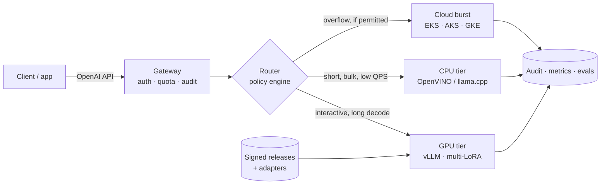

# SLM Serving Fabric

Serve a fine-tuned small language model privately, behind one OpenAI-compatible API, with a
router that picks the right compute tier per request and an audit trail that says why.

A runnable docker compose stack on one GPU. Kubernetes, OpenShift and air-gap overlays on top.
Not a slide deck.

**Status:** all six phases are built and measured on an RTX 4080 laptop — GPU tier, gateway,
simulated CPU and cloud tiers, two QLoRA adapters, a policy router with canary, breakers and
a hash-chained audit trail, benchmarks, a golden-set release gate, an ownership cost model,
cluster overlays, and signed release manifests. Tests and validators are green in CI.

---

## Watch it first

86 seconds, from the customer problem to the five decisions a private LLM platform has to get
right: tier routing, tenant isolation, release, audit, and running it on a mixed CPU/GPU
cluster.

https://github.com/user-attachments/assets/76f6f3ff-0aeb-4a51-941e-50c34b7980a4

---

## The idea in one minute

A 1–8B model, fine-tuned on one narrow task and served on the right runtime for its tier,
gets most of the way to a frontier model at a fraction of the cost — **if** the platform can
decide, per request, which model, which tier and which quantisation still meets the SLO
inside the customer's perimeter.

Most "private LLM" setups stop at one vLLM deployment behind an API key. That is the easy
20%. This repo builds the other 80%:

| The hard part | What this repo does |
|---|---|
| GPU or CPU? | A policy router admits and scores candidates on region, data class, context budget, cost and health — not vibes |
| Tenants, residency, air gap | Per-tenant keys, quotas, region and data-class rules; a confidential EU request cannot be sent to the US cloud tier |
| Shipping a model safely | QLoRA adapters hot-loaded into one base; canary by tenant, instant rollback, golden-set gate before promotion |
| Proving what happened | Every response names its route; every inference appends to a hash-chained audit log |

---

## Run it

You need Docker with Compose v2 and, for the real model, an NVIDIA GPU with ~12 GB VRAM.
`make` is a convenience, never a requirement.

| You need | Why | Check |
|---|---|---|
| Docker Desktop or Engine + Compose v2 | runs every service | `docker compose version` |
| NVIDIA GPU, ~12 GB VRAM, working driver | serves the 4B AWQ model | `nvidia-smi` |
| ~20 GB disk, 10–20 min on first start | image builds and model download | `df -h` |
| Python 3.10+ | preflight and smoke scripts | `python --version` |

No GPU? You can still run the tests and the deployment checks:
`make test` and `make deploy-validate`. The full stack will not start, because the gateway
waits for the GPU tier to be healthy.

**1. Get the code**

```bash
git clone https://github.com/mahi80/SLM-FIne-Tuned-Inference.git
cd SLM-FIne-Tuned-Inference
```

**2. Check the machine, then create the local config**

```bash
python scripts/doctor.py        # prints PASS / WARN / FAIL only; installs nothing
python scripts/doctor.py --fix  # if .env or config/tenants.yaml is missing
```

The tenant keys in the example are local demo keys. Replace them in `config/tenants.yaml`
(gitignored) before the gateway is reachable from anywhere else.

**3. Start it**

```bash
make up          # or: docker compose up -d --wait
```

First run builds two images and downloads the pinned weights. vLLM can take up to 10 minutes
to become healthy.

**4. Prove it works**

```bash
make ps             # every service healthy
make health         # aliases, policy version, breaker state
make smoke-gateway  # auth, GPU streaming, simulated CPU tier, metrics
```

Then one request:

```bash
curl -s http://localhost:8020/v1/chat/completions \
  -H 'Authorization: Bearer dev-acme-key' \
  -H 'Content-Type: application/json' \
  -d '{"model":"slm-small","messages":[{"role":"user","content":"hello"}],"max_tokens":32}'
```

**5. Look around**

| Service | URL | Notes |
|---|---|---|
| Grafana | http://localhost:3001 | `admin` / `admin`, dashboard **SLM Serving Fabric** |
| Prometheus | http://localhost:9090 | scrapes gateway, both simulators and vLLM |
| Gateway (OpenAI API) | http://localhost:8020 | `Authorization: Bearer dev-acme-key` |
| GPU tier | http://localhost:8010 | direct; bypasses the gateway |
| CPU tier (simulated) | http://localhost:8011 | answers carry `x-simulated: true` |
| Cloud tier (simulated) | http://localhost:8012 | residency-gated standby |

**6. Stop**

```bash
make down    # keeps the model cache and dashboards
make clean   # also deletes the data volumes
```

### If something goes wrong

| Symptom | Fix |
|---|---|
| `make: command not found` | Use the raw command shown beside each step. |
| `doctor` says Docker is not running | Start Docker Desktop, wait for “Engine running”, rerun. |
| No NVIDIA GPU / no nvidia runtime | Install the driver and enable GPU support in Docker Desktop (or `nvidia-container-toolkit`); `make gpu-check` must show `nvidia-smi` output. |
| A port is taken | Change the matching `*_PORT` in `.env` (e.g. `GATEWAY_PORT=8120`) and `make up` again. |
| Gateway unhealthy | `docker compose logs -f vllm-gpu`; first start may take 10 minutes. |
| `401` | Use a key from your local `config/tenants.yaml` (`dev-acme-key` is the example). |

More detail: `python scripts/doctor.py` names the exact fix for each FAIL.

### Everyday commands

```bash
make logs          # follow all services
make test          # 168 unit tests, no GPU or cluster needed
make smoke-policy  # admission, residency veto, canary stability, audit chain
make adapter-train # QLoRA v1/v2, then hot-load them (~25 min of GPU)
make bench         # tier benchmark matrix
make eval-gate     # golden-set release gate
make cost          # ownership cost per 1M output tokens
make release-check # manifest = policy = adapters = overlays = compose
make cluster-health # live cluster: nodes, GPU capacity, endpoints, gateway health
make signoff       # tests, both validators, signature; rewrites evidence.json
```

---

## What you can ask for

Clients ask for an **alias**, never a weights path or a tier. That indirection is what lets
the router honour residency rules and lets a release swap weights without touching app code.

| Alias | What it resolves to |
|---|---|
| `slm-small` | GPU primary, CPU and cloud standbys |
| `slm-small-cpu` | pins the simulated CPU tier |
| `slm-triage` | release alias: v1 primary, v2 canary at 50% sticky per tenant |
| `slm-triage-v2` | pins adapter v2 |

Every response carries its decision: `x-tier`, `x-route-reason`, `x-policy-version`,
`x-fallback`, `x-canary`, `x-model-version`, and `x-simulated` for modelled tiers.

---

## How it fits together



- **Gateway** — bearer auth with constant-time comparison, per-tenant rate limits, unbuffered
  streaming, usage accounting, hash-chained audit.
- **Router** — admits candidates against tenant, region, data class, context and breaker
  state, then scores what is left. Canary by `blake2b(alias, tenant)`. Reload is atomic: a bad
  file returns 422 and the old policy keeps serving.
- **Tiers** — one real GPU with two QLoRA adapters; calibrated CPU and cloud simulators that
  label every response `x-simulated: true`.
- **Releases** — a signed manifest pins the model revision, adapter digests, image digests,
  policy hash and gate verdict. `make release-check` fails on drift.

---

## What is real, and what is modelled

| Layer | Status |
|---|---|
| GPU tier, adapters, gateway, router, audit, benchmarks, eval gate, cost model | **Measured** on this machine |
| CPU and cloud tiers | **Modelled** — calibrated simulators, `x-simulated: true` |
| Vanilla Kubernetes overlay, Kyverno, Argo CD | **Observed** on a kind cluster (A-17…A-21) |
| OpenShift overlay, GPU autoscaling, air-gap mirror, release hooks | **Static validation only** |
| Signed release manifest, CI pipeline | **Verified** — signature, drift checks and a green CI run |

Numbers from a simulated tier are labelled `MODELLED` everywhere they appear. The full table,
with evidence links for every row, is in
[technical notes](docs/technical-notes.md#what-is-real-and-what-is-modelled).

---

## Results at a glance

Same prompt, 64 output tokens, closed-loop, measured on an RTX 4080 Laptop (12 GB):

| Target | Source | c | Output tok/s | TTFT p50 | Total p50 |
|---|---|---:|---:|---:|---:|
| GPU direct | measured | 1 | 125.5 | 20 ms | 509 ms |
| GPU direct | measured | 12 | 1,123.2 | 53 ms | 569 ms |
| Adapter v2 | measured | 12 | 850.9 | 128 ms | 683 ms |
| CPU simulator | MODELLED | 12 | 122.2 | 121 ms | 4,185 ms |

The GPU scales **9×** from one to twelve clients while p50 latency moves 509 → 569 ms. The
adapter costs 15–25% of aggregate throughput — the price of the contract it enforces. The CPU
tier saturates around 122 tok/s: it is a deadline tier, not a cheap GPU.

Golden-set release gate, 24 hand-labelled tickets: base model 4.2% exact, v1 75.0% (fails the
schema floor), **v2 83.3% — PASS**. Both adapters train in 13–15 minutes and add ~590 MiB of
VRAM when loaded together.

Owned GPU cost at 35% utilisation: **$0.117 per 1M output tokens**; break-even against the
cloud profile is 56,069 requests/day. Method and limits in
[benchmarks and cost](docs/technical-notes.md#benchmarks-release-gates-and-cost).

---

## Where things live

```
compose.yaml           the whole platform: tiers, gateway, observability
config/                pool registry, policy, bench, eval gates, cost, release pins, tenant example
src/                   gateway, router, tiersim, registry, bench, eval, cost
finetune/              prompt contract, dataset generator, QLoRA trainer, evaluation
deploy/                kustomize overlays (openshift/vanilla/airgap), GitOps, Kyverno, node pools
release/               signed manifest, detached signature, public key
docs/                  ADRs, C4 views, sign-off pack, technical notes
tests/ + tools/        unit tests, deployment and release validators
```

Full map: [repository map](docs/technical-notes.md#repository-map).

---

## Go deeper

| If you want | Read |
|---|---|
| Evidence, contracts and measurement detail | [docs/technical-notes.md](docs/technical-notes.md) |
| Why each decision was made | [ADR-0001…0008](docs/adr/) — one record per choice |
| Cluster deployment and air gap | [Kubernetes and OpenShift](docs/technical-notes.md#kubernetes-and-openshift) |
| The release and review pack | [Signed releases](docs/technical-notes.md#signed-releases-and-the-review-pack), [docs/signoff/](docs/signoff/) |
| What was not proven | [acceptance.md](docs/signoff/acceptance.md) — A-01…A-25, N-01…N-11, C-01…C-10 |

---

## Limits, stated plainly

- CPU and cloud throughput are **modelled**, calibrated against a documented profile.
- OpenShift, the air-gap mirror and the release hooks are **statically validated**, not
  observed on a live cluster.
- The gateway is deliberately **one replica**: quotas, breakers and the audit chain live
  in-process. Scaling it needs a shared counter first.
- Audit is tamper **evidence**, not prevention — the head hash needs an external, append-only
  sink in production.
- The 24-ticket golden set catches contract breakage; it cannot estimate a population.
- The AWQ build is a pinned community artifact. A regulated deployment should re-quantise
  in-house from official weights ([ADR-0002](docs/adr/ADR-0002-quantisation.md)).

---

## Weights and licences

Base model: [Qwen3-4B-Instruct-2507](https://huggingface.co/Qwen/Qwen3-4B-Instruct-2507)
(Apache-2.0), pinned at `cdbee75f` for training. AWQ build:
`cyankiwi/Qwen3-4B-Instruct-2507-AWQ-4bit`, pinned by revision. Runtime: vLLM (Apache-2.0).
Training data is generated and contains no customer records. No model or adapter weights are
vendored into this repository.
