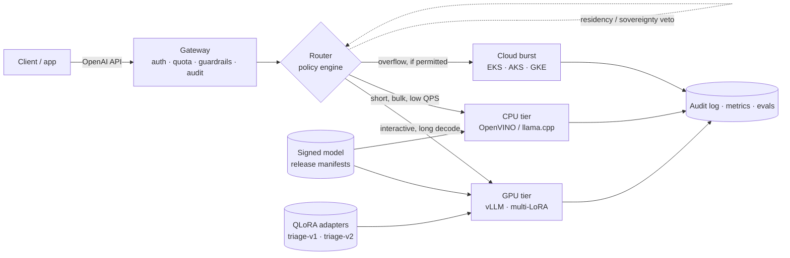

# SLM Serving Fabric

Private, provider-agnostic serving for fine-tuned small language models — a runnable
reference platform, not a slide deck.

**Status:** Phase 2 of 6 — GPU tier, gateway, simulated CPU tier, observability and two
QLoRA adapters are live and measured.

---

## Thesis

A 1–8B model, fine-tuned on a narrow enterprise task and served with the right runtime
per compute tier, delivers most of the quality of a frontier model at a fraction of the
cost — provided the platform can decide, per request, **which model, which tier, and
which quantisation** still satisfies the SLO inside the customer's perimeter.

Most "private LLM" architectures stop at a single vLLM deployment behind an API key.
That is the easy 20%. The remaining 80% is:

- choosing between **GPU and CPU** on latency, cost and concurrency — not on vibes;
- keeping **tenants, data residency and air-gapped sites** from leaking into each other;
- shipping a **model release** through gates, canary, and rollback without a redeploy;
- proving **why** every request went where it went, to an auditor.

This repo builds that platform, and documents the decisions as reviewable ADRs.

---

## What is real, and what is modelled

An architecture document that blurs this line is worthless in review, so the repo keeps
the distinction explicit:

| Layer | Status | Evidence |
|---|---|---|
| GPU tier (vLLM, AWQ W4A16, multi-LoRA capable) | **Measured** | `make smoke`, tables below |
| Fine-tuned adapters (QLoRA v1/v2, hot load / unload) | **Measured** | `make adapter-train`, `make adapter-smoke`, eval table below |
| Gateway (auth, quotas, streaming proxy, audit) | **Measured** | `make smoke-gateway` |
| Observability (Prometheus + provisioned Grafana) | **Measured** | dashboard `slm-platform`, 7 panels |
| CPU tier (OpenVINO / llama.cpp on Xeon/EPYC) | **Modelled** — calibrated simulator, no Xeon on this laptop | `src/tiersim`, labelled `x-simulated: true` |
| Cloud burst tiers (EKS / AKS / GKE) | Profile defined, not wired | `src/tiersim/profiles.py` |
| OpenShift / air-gapped deployment | **Static validation** — manifests render and pass policy checks; no cluster available | `deploy/openshift` |
| Router policy engine, governance, release pipeline | Planned (Phases 3–5) | — |

Numbers from a simulated tier are labelled `MODELLED` everywhere they appear.

---

## Architecture



The platform contract is deliberately portable: Kubernetes + Gateway API + OCI registry +
S3-compatible object storage + OIDC. **OpenShift is the reference substrate**; EKS, AKS and
GKE differ only in node pools, storage class, KMS and DNS.

---

## Quickstart

Requirements: Docker Desktop (WSL2 backend), an NVIDIA GPU with a working Windows driver,
Python 3.10+, ~12 GB free VRAM and ~15 GB disk.

```bash
make gpu-check     # NVIDIA GPU visible inside a container
make up            # build, pull, download weights, wait until every service is healthy
make smoke         # GPU tier directly
make smoke-gateway # both tiers through the gateway
make adapter-train # QLoRA adapters v1/v2, then hot-load them (takes the GPU ~25 min)
make adapter-smoke # adapter aliases end to end through the gateway
make adapter-eval  # base vs v1 vs v2 on the held-out triage set
make logs          # follow all services
make down          # stop (model cache and dashboards are kept)
```

| Service | URL | Notes |
|---|---|---|
| Gateway (OpenAI API) | http://localhost:8020 | `Authorization: Bearer dev-acme-key` |
| GPU tier | http://localhost:8010 | direct; bypasses the gateway |
| CPU tier (simulated) | http://localhost:8011 | direct; responses carry `x-simulated: true` |
| Prometheus | http://localhost:9090 | scrapes gateway, simulator and vLLM |
| Grafana | http://localhost:3001 | `admin` / `admin`, dashboard **SLM Serving Fabric** |

Clients send the same OpenAI request to the gateway and pick a tier with the model alias:

```bash
curl -s http://localhost:8020/v1/chat/completions \
  -H 'Authorization: Bearer dev-acme-key' \
  -H 'Content-Type: application/json' \
  -d '{"model":"slm-small","messages":[{"role":"user","content":"hello"}],"max_tokens":32}'
```

`slm-small` resolves to the GPU tier, `slm-small-cpu` to the simulated CPU tier, and
`slm-triage` / `slm-triage-v2` to the two fine-tuned adapters on the same GPU tier. Clients
address an alias, never a weights path — that indirection is what lets a release swap
weights or an adapter without touching application code.

Host ports are configurable in `.env`; 8000 is deliberately avoided because it is commonly
already taken on developer machines.

---

## Measured on this machine

Host: RTX 4080 Laptop GPU, 12 GB VRAM · Docker 29.4 · vLLM `v0.33.0`

| Metric | Value |
|---|---|
| Model | Qwen3-4B-Instruct-2507, AWQ W4A16 via compressed-tensors |
| Weights revision | `b37d1cc` (pinned SHA) |
| Context / max sequences | 8,192 tokens · 16 |
| KV cache | 5.93 GiB → 43,136 tokens → 5.3× concurrent 8k requests |
| VRAM in use | 9,975 / 12,282 MiB |
| VRAM with both LoRA adapters | 10,563 / 12,282 MiB |
| Engine init | 30.5 s (model load, profiling, CUDA graph capture) |
| Time to first token | 234 ms first request · **20 ms** median warm |
| Decode throughput | **128.5 tok/s** median, 5 runs of 80–96 tokens |
| Structured output | valid strict JSON on the extraction prompt |

```text
$ make smoke
endpoint  http://localhost:8010
models    ['slm-small']
ttft      0.243 s
decode    68.7 tok/s over 35 tokens
latency   0.753 s total
json      {"customer": "Acme", "product": "X200 pump", "sentiment": "negative"}
PASS
```

The 35-token run is slower than the 90-token median because fixed per-request overhead
dominates short generations; decode throughput is the metric that matters for tiering.
5.9 GiB of KV cache is deliberate headroom for multiple LoRA adapters in Phase 2.

*Note: numbers are from a laptop RTX 4080 (12 GB). They demonstrate the tier is real and
calibrate the cost model — they are not a capacity plan for datacentre GPUs.*

### Tier comparison through the gateway

Same prompt, 90-token budget, median of three streaming requests:

| Tier | TTFT | Total | Throughput | Cost / 1M output tokens |
|---|---|---|---|---|
| GPU (measured) | 33 ms | **0.74 s** | ~122 tok/s | not metered locally |
| CPU (MODELLED) | 93 ms | **5.77 s** | ~16 tok/s | $8.80 |
| GPU reference profile (MODELLED) | — | — | ~500 tok/s aggregate | $0.33 |

Queueing is real, not decorative: 12 concurrent requests against 8 CPU slots produced a
median of 1.32 s and a maximum of 2.61 s — the second half genuinely waited for a slot.

The 7.8x latency gap at identical output length is the routing problem in one table. It is
also why CPU is not a "cheap GPU": per output token it is roughly 25x more expensive here,
and wins only against an already-idle GPU, a latency-tolerant deadline, or no GPU at all.

### Failover is proven, not asserted

With the GPU container stopped, `slm-small` returned **200 from the CPU tier** with
`x-tier: cpu` and `x-fallback: true`. The GPU was then restarted and served normally.

---

## Gateway contract

Every response carries its routing decision:

| Header | Meaning |
|---|---|
| `x-request-id` | Correlates the audit line, gateway metrics and upstream logs |
| `x-route-alias` | The route that actually served the request |
| `x-tier` | `gpu`, `cpu` (later also `cloud`) |
| `x-route-reason` | Why this route was chosen — static in Phase 1, policy-driven in Phase 3 |
| `x-policy-version` | Version of the table or policy that decided |
| `x-fallback` | `true` when the primary route failed and the fallback served |
| `x-simulated` | Present and `true` only for modelled tiers |

Working today: bearer auth with constant-time key comparison, per-tenant sliding-window
RPM limits (429 with `Retry-After`), unbuffered streaming pass-through, usage accounting
taken from upstream, one structured audit line per request, and one fallback attempt on
connection failure.

Deliberately absent until Phase 3: quality-aware routing, shadow traffic, circuit breakers,
and a shared quota counter for multi-replica gateways. The in-memory limiter is explicitly
single-replica; pretending otherwise would be the kind of gap that fails an architecture
review.

---

## Fine-tuning: two adapters, one contract

The narrow task is **support-ticket triage** for an industrial tenant. The model must emit
strict JSON against a fixed taxonomy and a severity rubric — exactly the kind of contract a
general model drifts on:

```json
{"category": "technical", "priority": "P2", "sentiment": "negative",
 "escalate": true, "product": "X200 pump", "summary": "Line stopped at the north plant"}
```

`finetune/prompt.py` holds the system prompt, schema and rubric that training, evaluation
and callers share. Violating the schema is a bug; guessing a different taxonomy is a bigger
one.

**Data is generated, not scraped.** `finetune/dataset.py` builds 25 clean scenarios and 18
adversarial ones (sarcasm, conflicting urgency, multi-issue, missing model number, typos,
mixed language, angry-but-trivial) with labels from the scenario definition. Splits:

| Split | Rows | Content |
|---|---|---|
| `train-v1` | 320 | clean scenarios, first two paraphrases |
| `train-v2` | 336 | 240 clean + 96 adversarial |
| `eval` | 200 | 80 clean + 80 adversarial paraphrases + 40 tickets from four families never trained on |

**Training:** QLoRA (4-bit NF4, bf16 compute) on the official BF16 base
(`Qwen/Qwen3-4B-Instruct-2507`, pinned SHA), LoRA r=16 / α=32 / dropout 0.05 on all linear
layers. 33.0 M trainable parameters (0.81%). One adapter takes 320–336 steps, 13–15 minutes
on the RTX 4080, with the GPU tier stopped.

**Serving:** the adapter runs on the **AWQ base** via multi-LoRA, not a merged checkpoint.
This was verified before training: a probe adapter loaded onto the compressed-tensors AWQ
model and served under its own name, which is why `--enable-lora` is safe here. See
[ADR-0003](docs/adr/ADR-0003-adapters.md).

### Held-out results

200 tickets, temperature 0. "Exact" means category, priority, sentiment, escalate and
product all correct; strict JSON is `json.loads` of the raw answer with no trimming.

| Model | Strict JSON | Schema | Exact labels | Category | Priority | Sentiment | Escalate | Product | Clean | Hard | Held-out |
|---|---|---|---|---|---|---|---|---|---|---|---|
| base `slm-small` | 100% | 99.0% | **19.5%** | 80.0% | 70.0% | 81.0% | 76.0% | 38.0% | 23.7% | 15.0% | 20.0% |
| adapter v1 | 100% | 99.0% | **73.5%** | 98.5% | 85.0% | 86.5% | 93.0% | 96.0% | 77.5% | 57.5% | 97.5% |
| adapter v2 | 100% | 100% | **79.0%** | 97.0% | 100% | 86.0% | 93.0% | 97.0% | 85.0% | 76.2% | 72.5% |

- The base model writes valid JSON but invents taxonomy (`"category": "security"`,
  `"feature request"`) and misses product extraction 62% of the time. Fine-tuning buys the
  contract, not just the syntax.
- v1 is clean-data-only: strong on easy tickets, **57.5%** on adversarial input, and it
  reads sarcasm as positive sentiment.
- v2 is trained on clean + adversarial data: **76.2%** on the hard slice, 100% schema, and
  it handles the sarcasm case correctly. Its held-out dip is concentrated in two paraphrases
  whose generated labels are genuinely arguable, not in structure.
- Training loss fell below `1e-5` within two epochs in both runs, i.e. it memorised the
  templates. Promotion is therefore decided by the held-out eval, never by loss.

```text
$ make adapter-smoke
gateway   http://localhost:8020
models    ['slm-small', 'slm-small-cpu', 'slm-triage', 'slm-triage-v2']
sarcasm         base=P2/positive v1=P2/positive v2=P2/negative
feature-request base=P4/positive v1=P4/positive v2=P4/positive
calm-outage     base=P2/neutral v1=P2/negative v2=P2/neutral
PASS
```

### Promotion and rollback without a redeploy

Adapters are loaded through vLLM's control API and addressed as model names:

```bash
curl -s -X POST http://localhost:8010/v1/load_lora_adapter \
  -H 'Content-Type: application/json' \
  -d '{"lora_name":"triage-v2","lora_path":"/adapters/triage-v2"}'

curl -s -X POST http://localhost:8010/v1/unload_lora_adapter \
  -H 'Content-Type: application/json' -d '{"lora_name":"triage-v2"}'
```

Rollback was exercised end to end: after unload, `slm-triage-v2` returns **404** while
`slm-triage` keeps serving; reload restores **200**. Both adapters together add ~590 MiB of
VRAM (9,975 → 10,563 of 12,282 MiB). Adapter weights are build artifacts, git-ignored and
reproduced by `make adapter-train`; `training.json` records data, base revision,
hyper-parameters and the loss curve.

---

## Repository map

```
compose.yaml                     the whole platform: tiers, gateway, observability
Makefile                         operational entry points
config/routes.yaml               alias → backend table (Phase 3 replaces the lookup)
config/tenants.example.yaml      tenant keys and quotas; tenants.yaml is gitignored
scripts/smoke.py                 GPU tier smoke test
scripts/smoke_gateway.py         end-to-end test through the gateway, both tiers
scripts/smoke_adapters.py        adapter aliases and contract check through the gateway
scripts/load_adapters.py         runtime load of every adapter into vLLM
docker/                          gateway, simulator and QLoRA training images
src/gateway/                     OpenAI-compatible API, auth, quotas, proxy, audit
src/router/                      policy engine: admissibility, tier scoring, breakers
src/tiersim/                     calibrated CPU / cloud tier simulator
src/registry/                    signed model release manifests
src/eval/                        golden sets, deterministic checks, drift detection
deploy/observability/grafana/    provisioned datasource and dashboard
deploy/openshift/                SCC, Route, ImageStream, GPU Operator, IDMS/ITMS
deploy/kustomize/                overlays: openshift, vanilla k8s, airgap
deploy/policies/                 Kyverno / Gatekeeper admission policy
deploy/gitops/                   Argo CD app-of-apps, Rollouts analysis
finetune/prompt.py               task contract: system prompt, schema, taxonomy
finetune/dataset.py              deterministic triage dataset generator
finetune/train_qlora.py          QLoRA trainer (4-bit NF4, assistant-only loss)
finetune/evaluate.py             strict JSON / schema / per-field evaluation
finetune/data/                   generated train-v1, train-v2 and eval splits
adapters/                        trained adapter artifacts (gitignored, reproducible)
bench/                           load generator and recorded results
docs/adr/                        architecture decision records
docs/signoff/                    architecture review template and completed review
```

---

## Decisions taken in Phase 0
**Pinned everything.** The runtime is pinned to `vllm/vllm-openai:v0.33.0` and the weights
to a commit SHA, not `main`. A serving node is a reproducible artifact; `latest` means the
model can change under a running release without anyone noticing.

**AWQ INT4, not FP8.** The target GPU is Ada (sm_89), which has no FP8 tensor cores. FP8
would fall back to dequantise-on-the-fly and lose to INT4 on both latency and memory.

**Third-party quantisation is a recorded risk.** Qwen does not publish an official AWQ
build of the 2507 Instruct 4B, so Phase 0 pins a community AWQ artifact by revision. This
is acceptable for a reference build and unacceptable for regulated production — Phase 4
re-quantises in-house from official weights and records provenance per release. This is
ADR-0002 once the ADR series lands.

**Headroom is reserved on purpose.** 8k context and 16 concurrent sequences leave VRAM
for multiple LoRA adapters in Phase 2, rather than maxing out a single-model deployment.

**One tier per container, one alias per model.** Scaling, quotas and failure domains follow
the tier; routing and release management follow the alias.

### Phase 1

**The simulator is a timing model, not a fake model.** `src/tiersim` returns canned text but
reproduces prefill, per-token decode and queueing from a documented profile, and tags every
response `x-simulated: true`. Its numbers are labelled MODELLED. Its job is to let the
router, dashboards and cost model be built before CPU hardware exists.

**Routing is a table, but the contract is already final.** Phase 3 swaps the lookup for
policy evaluation; clients already see `x-route-reason`, `x-policy-version` and `x-fallback`,
so the client contract will not change when the policy engine arrives.

**Fallback is connection-level only.** A refused connection fails over to the next route; a
500 does not, because silently downgrading a tier after an application error hides bugs.
Quality-aware failover is a Phase 3 policy decision.

**No buffering in the proxy.** Responses are relayed chunk by chunk. The injected
`stream_options.include_usage` is stripped unless the client asked for it, so usage can be
metered without changing the caller's stream shape.

**Tenant secrets never enter git.** `config/tenants.yaml` is generated from an example file
and gitignored; the gateway mounts the config directory read-only.

### Phase 2

**Adapters, not merged weights.** Merging a LoRA into BF16 and re-quantising would produce
one artifact per experiment and make rollback a weight deployment. Serving adapters against
the pinned AWQ base keeps one base in VRAM, lets both releases run side by side, and turns
promotion into a routing change.

**The eval decides, the loss does not.** Both runs memorised their templates (loss < 1e-5 by
epoch two). The held-out set, including four adversarial families never trained on, is the
promotion gate; v2 was selected on the hard slice, not on training loss.

**Runtime load is the release primitive.** `load_lora_adapter` / `unload_lora_adapter` are
exercised in the smoke path, so a canary or rollback needs no restart. Adapters are artifacts:
git-ignored, recorded in `training.json`, reproducible with one command.

**Adapters do not pretend to have a CPU fallback.** The simulator cannot serve LoRA, so the
adapter aliases declare no fallback and fail fast rather than answering with the wrong model.

---

## Roadmap

| Phase | Scope | Status |
|---|---|---|
| 0 | Scaffold, GPU passthrough, vLLM serving, smoke test | **Done** |
| 1 | Gateway, CPU tier simulator, Prometheus + Grafana | **Done** |
| 2 | QLoRA adapters v1/v2, multi-LoRA hot loading | **Done** |
| 3 | Router policy engine, canary, audit trail | Next |
| 4 | Benchmarks, eval harness, cost model | |
| 5 | OpenShift / air-gap manifests, GitOps, admission policy | |
| 6 | ADRs, C4 diagrams, architecture sign-off pack | |

---

## Weights and licences

Base model: [Qwen3-4B-Instruct-2507](https://huggingface.co/Qwen/Qwen3-4B-Instruct-2507)
(Apache-2.0), pinned at `cdbee75f` for training. AWQ build:
`cyankiwi/Qwen3-4B-Instruct-2507-AWQ-4bit`, pinned by revision. Runtime: vLLM (Apache-2.0).
Training data is generated and contains no customer records. No model weights or adapter
weights are vendored into this repository.
