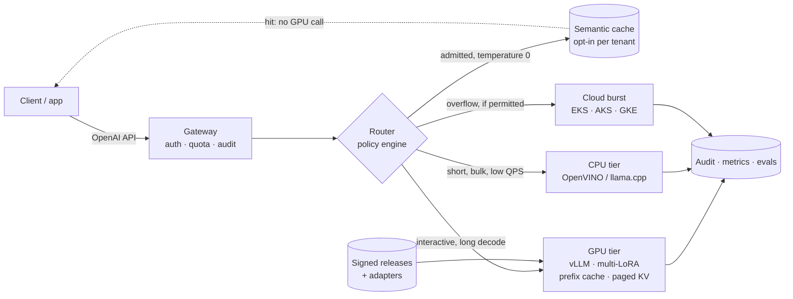

# SLM Serving Fabric

Serve a fine-tuned small language model privately, behind one OpenAI-compatible API, with a
router that picks the right compute tier per request and an audit trail that says why.

A runnable docker compose stack on one GPU. Kubernetes, OpenShift and air-gap overlays on top.
Not a slide deck.

**Status:** all six phases are built and measured on an RTX 4080 laptop — GPU tier, gateway,
simulated CPU and cloud tiers, two QLoRA adapters, a policy router with canary, breakers and
a hash-chained audit trail, benchmarks, a golden-set release gate, an ownership cost model,
cluster overlays, and signed release manifests. Tests and validators are green in CI.

---

## Watch it first

86 seconds, from the customer problem to the five decisions a private LLM platform has to get
right: tier routing, tenant isolation, release, audit, and running it on a mixed CPU/GPU
cluster.

https://github.com/user-attachments/assets/76f6f3ff-0aeb-4a51-941e-50c34b7980a4

---

## The idea in one minute

A 1–8B model, fine-tuned on one narrow task and served on the right runtime for its tier,
gets most of the way to a frontier model at a fraction of the cost — **if** the platform can
decide, per request, which model, which tier and which quantisation still meets the SLO
inside the customer's perimeter.

Most "private LLM" setups stop at one vLLM deployment behind an API key. That is the easy
20%. This repo builds the other 80%:

| The hard part | What this repo does |
|---|---|
| GPU or CPU? | A policy router admits and scores candidates on region, data class, context budget, cost and health — not vibes |
| Tenants, residency, air gap | Per-tenant keys, quotas, region and data-class rules; a confidential EU request cannot be sent to the US cloud tier |
| Shipping a model safely | QLoRA adapters hot-loaded into one base; canary by tenant, instant rollback, golden-set gate before promotion |
| Proving what happened | Every response names its route; every inference appends to a hash-chained audit log |

---

## Run it

You need Docker with Compose v2 and, for the real model, an NVIDIA GPU with ~12 GB VRAM.
`make` is a convenience, never a requirement.

| You need | Why | Check |
|---|---|---|
| Docker Desktop or Engine + Compose v2 | runs every service | `docker compose version` |
| NVIDIA GPU, ~12 GB VRAM, working driver | serves the 4B AWQ model | `nvidia-smi` |
| ~20 GB disk, 10–20 min on first start | image builds and model download | `df -h` |
| Python 3.10+ | preflight and smoke scripts | `python --version` |

No GPU? You can still run the tests and the deployment checks:
`make test` and `make deploy-validate`. The full stack will not start, because the gateway
waits for the GPU tier to be healthy.

**1. Get the code**

```bash
git clone https://github.com/mahi80/SLM-FIne-Tuned-Inference.git
cd SLM-FIne-Tuned-Inference
```

**2. Check the machine, then create the local config**

```bash
python scripts/doctor.py        # prints PASS / WARN / FAIL only; installs nothing
python scripts/doctor.py --fix  # if .env or config/tenants.yaml is missing
```

The tenant keys in the example are local demo keys. Replace them in `config/tenants.yaml`
(gitignored) before the gateway is reachable from anywhere else.

**3. Start it**

```bash
make up          # or: docker compose up -d --wait
```

First run builds two images and downloads the pinned weights. vLLM can take up to 10 minutes
to become healthy.

**4. Prove it works**

```bash
make ps             # every service healthy
make health         # aliases, policy version, breaker state
make smoke-gateway  # auth, GPU streaming, simulated CPU tier, metrics
```

Then one request:

```bash
curl -s http://localhost:8020/v1/chat/completions \
  -H 'Authorization: Bearer dev-acme-key' \
  -H 'Content-Type: application/json' \
  -d '{"model":"slm-small","messages":[{"role":"user","content":"hello"}],"max_tokens":32}'
```

**5. Look around**

| Service | URL | Notes |
|---|---|---|
| Grafana | http://localhost:3001 | `admin` / `admin`, dashboard **SLM Serving Fabric** |
| Prometheus | http://localhost:9090 | scrapes gateway, both simulators and vLLM |
| Gateway (OpenAI API) | http://localhost:8020 | `Authorization: Bearer dev-acme-key` |
| GPU tier | http://localhost:8010 | direct; bypasses the gateway |
| CPU tier (simulated) | http://localhost:8011 | answers carry `x-simulated: true` |
| Cloud tier (simulated) | http://localhost:8012 | residency-gated standby |

**6. Stop**

```bash
make down    # keeps the model cache and dashboards
make clean   # also deletes the data volumes
```

### If something goes wrong

| Symptom | Fix |
|---|---|
| `make: command not found` | Use the raw command shown beside each step. |
| `doctor` says Docker is not running | Start Docker Desktop, wait for “Engine running”, rerun. |
| No NVIDIA GPU / no nvidia runtime | Install the driver and enable GPU support in Docker Desktop (or `nvidia-container-toolkit`); `make gpu-check` must show `nvidia-smi` output. |
| A port is taken | Change the matching `*_PORT` in `.env` (e.g. `GATEWAY_PORT=8120`) and `make up` again. |
| Gateway unhealthy | `docker compose logs -f vllm-gpu`; first start may take 10 minutes. |
| `401` | Use a key from your local `config/tenants.yaml` (`dev-acme-key` is the example). |

More detail: `python scripts/doctor.py` names the exact fix for each FAIL.

### Everyday commands

```bash
make logs          # follow all services
make test          # 362 unit tests, no GPU or cluster needed
make smoke-policy  # admission, residency veto, canary stability, audit chain
make adapter-train # QLoRA v1/v2, then hot-load them (~25 min of GPU)
make bench         # tier benchmark matrix
make eval-gate     # golden-set release gate
make cost          # ownership cost per 1M output tokens
make release-check # manifest = policy = adapters = overlays = compose
make fleet-check   # every pool hosted by exactly one declared cluster
make cluster-health # live cluster: nodes, GPU capacity, endpoints, gateway health
make signoff       # tests, validators, fleet check, signature; rewrites evidence.json
```

---

## What you can ask for

Clients ask for an **alias**, never a weights path or a tier. That indirection is what lets
the router honour residency rules and lets a release swap weights without touching app code.

| Alias | What it resolves to |
|---|---|
| `slm-small` | GPU primary, CPU and cloud standbys |
| `slm-small-cpu` | pins the simulated CPU tier |
| `slm-triage` | release alias: v1 primary, v2 canary at 50% sticky per tenant |
| `slm-triage-v2` | pins adapter v2 |

Every response carries its decision: `x-tier`, `x-route-reason`, `x-policy-version`,
`x-fallback`, `x-canary`, `x-model-version`, and `x-simulated` for modelled tiers.

---

## How it fits together



- **Gateway** — bearer auth with constant-time comparison, per-tenant rate limits, unbuffered
  streaming, usage accounting, hash-chained audit.
- **Router** — admits candidates against tenant, region, data class, context and breaker
  state, then scores what is left. Canary by `blake2b(alias, tenant)`. Reload is atomic: a bad
  file returns 422 and the old policy keeps serving.
- **Semantic cache** — opt-in per tenant; deterministic near-duplicates are answered by the
  gateway after admission, scoped to tenant, route and conversation.
- **Tiers** — one real GPU with two QLoRA adapters; calibrated CPU and cloud simulators that
  label every response `x-simulated: true`.
- **Releases** — a signed manifest pins the model revision, adapter digests, image digests,
  policy hash and gate verdict. `make release-check` fails on drift.

---

## What is real, and what is modelled

| Layer | Status |
|---|---|
| GPU tier, adapters, gateway, router, audit, benchmarks, eval gate, cost model | **Measured** on this machine |
| CPU and cloud tiers | **Modelled** — calibrated simulators, `x-simulated: true` |
| Vanilla Kubernetes overlay, Kyverno, Argo CD | **Observed** on a kind cluster (A-17…A-21) |
| OpenShift overlay, GPU autoscaling, air-gap mirror, release hooks | **Static validation only** |
| Signed release manifest, CI pipeline | **Verified** — signature, drift checks and a green CI run |

Numbers from a simulated tier are labelled `MODELLED` everywhere they appear. The full table,
with evidence links for every row, is in
[technical notes](docs/technical-notes.md#what-is-real-and-what-is-modelled).

---

## Taking it to real infrastructure

This repository ships the application, its policy, the node-pool *contracts*, and three
bring-up scripts that build a managed cluster for them. It does not ship a cluster you can
log into, Terraform state, or a credential. Every script has a `--dry-run` that prints the
full plan — cluster, IAM roles, autoscaler, node pools, pinned add-ons — using only `bash`:

```bash
deploy/cloud/aws-eks-cluster.sh --dry-run
deploy/cloud/azure-aks-cluster.sh --dry-run
deploy/cloud/gcp-gke-cluster.sh --dry-run
```

Read the plan before running it for real; [deploy/cloud/README.md](deploy/cloud/README.md#bring-up-scripts)
lists what each script creates, every variable and what it deliberately leaves to you.

### Baseline every target needs

| Requirement | Why | Check |
|---|---|---|
| Kubernetes 1.31+ (1.34 verified on kind), or OpenShift 4.x | The manifests use `karpenter.sh/v1`, `subPath` Secret mounts and PSS `restricted`; the OpenShift overlay is statically validated, not run | `kubectl version` |
| One GPU node class and one CPU node class | `vllm-gpu` selects the GPU pool; the simulators prefer the CPU pool | `kubectl get nodes -L nvidia.com/gpu.present` |
| NVIDIA GPU Operator (driver, device plugin, NFD) | `deploy/cloud/bootstrap-addons.sh` installs it, pinned; without the device plugin `nvidia.com/gpu` never appears in `allocatable` | `kubectl get node <gpu> -o jsonpath='{.status.allocatable.nvidia\.com/gpu}'` |
| A storage class that supports `ReadWriteMany` | One replica runs on `ReadWriteOnce`; a second GPU replica shares the model and adapter claims, and the autoscaling component patches them to RWX | `kubectl get storageclass` |
| Argo CD and Kyverno, or your own equivalent | GitOps sync waves and the six `Enforce` policies | `kubectl get crd \| grep -E 'argoproj\|kyverno'` |
| Route/Ingress with TLS, and a default-deny NetworkPolicy | The gateway is reached over the edge, and egress is closed by default | `make cluster-health` |
| KEDA (optional, GPU pool only) | Queue-depth and KV-cache autoscaling; without it the GPU tier stays at one replica | `kubectl get scaledobject -n slm-fabric` |

### Provider credentials and quotas

Node pools are created by whoever owns the cluster. Use a role or service principal, never a
long-lived key committed or pasted anywhere.

| Provider | What the repo gives you | Credential you need | Permission scope | Quota to request first |
|---|---|---|---|---|
| **AWS / EKS** | `deploy/cloud/aws-karpenter-nodepools.yaml` (two `NodePool`s + `EC2NodeClass`) | An IAM role assumed by SSO, CI OIDC, or `aws sts assume-role`; Karpenter's controller identity via EKS Pod Identity/IRSA | Cluster admin to install Karpenter; its controller policy from the upstream docs plus `iam:PassRole` on the node role; node role `KarpenterNodeRole-slm-fabric` with `AmazonEKSWorkerNodePolicy`, `AmazonEKS_CNI_Policy`, `AmazonEC2ContainerRegistryReadOnly`; subnets and security groups tagged `karpenter.sh/discovery=slm-fabric` | EC2 **G-family vCPUs** (`g5`/`g6`, on-demand) in the target region; the snippet caps the GPU pool at 4 GPUs |
| **Azure / AKS** | `deploy/cloud/azure-aks-nodepools.sh` (`az aks nodepool add` ×2) | `az login` as a human, or a service principal/`az identity` used by CI | Contributor on the cluster resource group (`Microsoft.ContainerService/managedClusters/agentPools/*`), plus `Azure Kubernetes Service Cluster Admin Role` to read kubeconfig | `standardNCadsA100v4Family` vCPUs in the region (`az vm list-usage --location <region> -o table`); CPU `Ddsv5` quota |
| **Google / GKE** | `deploy/cloud/gcp-gke-nodepools.sh` (`gcloud container node-pools create` ×2) | `gcloud auth login`, or a service account key held in your CI secret store | `roles/container.admin`, `roles/compute.admin`, `roles/iam.serviceAccountUser` on the project; node service account `roles/container.defaultNodeServiceAccount` (or a custom role with logging and monitoring) | **`nvidia-l4` GPUs** in the region (`gcloud compute regions describe <region> --format='value(quotas)'`), or A100 if you change `GPU_TYPE`; `e2-standard-8` CPU quota |
| **On-prem / OpenShift** | `deploy/cloud/onprem-workers.sh` (labels + taints existing workers) | `oc login` as cluster admin (or an account allowed to label nodes and scale MachineSets) | `nodes` patch plus `machinesets` scale in `openshift-machine-api`; the GPU MachineSet is provisioned by the platform team | A `ReadWriteMany` storage class and enough GPUs for the replica bounds in `config/capacity.yaml` |

The node-pool snippets only add capacity to a cluster that already exists. For a
first cluster, `deploy/cloud/{aws-eks,azure-aks,gcp-gke}-cluster.sh` create the control plane,
the system pool, the autoscaler (Karpenter on EKS; the managed autoscaler on AKS and GKE) and
then call that provider's snippet; `bootstrap-addons.sh` installs the NVIDIA GPU Operator, KEDA,
Argo CD and Kyverno with pinned chart versions. Every pool is joined to the app by two labels
and two taints — see [the contract](deploy/cloud/README.md#the-contract). `make fleet-check`
validates the inventory in `config/fleet.yaml`; `python tools/fleet_status.py --live` shows how
many GPU nodes each cluster actually reports.

### Credentials the platform itself needs

These are created out of band, never committed, and every tool that reads them prints names,
not values.

| Secret | Needed for | How it is supplied |
|---|---|---|
| `slm-tenants` | Tenant bearer keys, RPM and admission fields | `make deploy-secret`, from the gitignored `config/tenants.yaml` |
| `slm-backend-keys` | External provider keys, OIDC client secrets | Secret in your store; mounted at `/app/backend-keys` and named by policy `access.key` |
| Projected token volume (optional) | `access.source: file` — a rotating service-account token | Your identity provider or platform's projected-token volume under `SLM_BACKEND_TOKEN_DIR` |
| Backend CA bundle (optional) | A provider whose certificate does not chain to public roots | `SLM_BACKEND_CA` pointing at a mounted bundle; a configured-but-missing bundle stops the gateway |
| `slm-keda-prometheus` | KEDA's Prometheus scaler | Created in-cluster with a token; not part of any overlay |

A model provider is reachable through the gateway only if it speaks the OpenAI API at
`/v1/chat/completions` and `/health`. OpenAI-compatible endpoints (vLLM/TGI/SGLang on your own
GPU, Together, Fireworks, DeepInfra, OpenAI) work with one key. **Azure OpenAI, Amazon Bedrock
and Google Vertex AI do not** — they need a thin fronting proxy, and the
[compatibility table](deploy/cloud/README.md#which-endpoints-actually-work) says why. External
backends also need the opt-in `cloud-egress` component and an `ipBlock` for the provider's
current range; DNS names cannot be expressed in a NetworkPolicy.

Before sending tenant traffic to any of it, run
`PYTHONPATH=src python -m tools.check_backend --policy config/policy.yaml --keys <keys.yaml>` —
one line per external candidate, exit 1 if any is unconfigured, unauthenticated or down.

**What this repo will not do for you:** run the bring-up scripts against your account, buy GPU
quota, or hold a credential. Those are the parts that cost money and need an account. The
scripts also stop at the cluster boundary: the tenant Secret, Argo CD's repository
registration, the `ReadWriteMany` storage class and the `config/fleet.yaml` entry stay yours,
because a script cannot know your identity provider or storage backend. No script here has
been run against a real account yet (R-17).

---

## Results at a glance

Same prompt, 64 output tokens, closed-loop, measured on an RTX 4080 Laptop (12 GB):

| Target | Source | c | Output tok/s | TTFT p50 | Total p50 |
|---|---|---:|---:|---:|---:|
| GPU direct | measured | 1 | 125.5 | 20 ms | 509 ms |
| GPU direct | measured | 12 | 1,123.2 | 53 ms | 569 ms |
| Adapter v2 | measured | 12 | 850.9 | 128 ms | 683 ms |
| CPU simulator | MODELLED | 12 | 122.2 | 121 ms | 4,185 ms |

The GPU scales **9×** from one to twelve clients while p50 latency moves 509 → 569 ms. The
adapter costs 15–25% of aggregate throughput — the price of the contract it enforces. The CPU
tier saturates around 122 tok/s: it is a deadline tier, not a cheap GPU.

Golden-set release gate, 24 hand-labelled tickets: base model 4.2% exact, v1 75.0% (fails the
schema floor), **v2 83.3% — PASS**. Both adapters train in 13–15 minutes and add ~590 MiB of
VRAM when loaded together.

Owned GPU cost at 35% utilisation: **$0.117 per 1M output tokens**; break-even against the
cloud profile is 56,069 requests/day. Method and limits in
[benchmarks and cost](docs/technical-notes.md#benchmarks-release-gates-and-cost).

---

## Where things live

```
compose.yaml           the whole platform: tiers, gateway, observability
config/                pool registry, fleet inventory, policy, bench, eval gates, cost, release pins
src/                   gateway, router, tiersim, registry, bench, eval, cost
finetune/              prompt contract, dataset generator, QLoRA trainer, evaluation
deploy/                kustomize overlays + cloud-egress, GitOps, Kyverno, node pools
release/               signed manifest, detached signature, public key
docs/                  ADRs, C4 views, sign-off pack, technical notes
tests/ + tools/        unit tests, deployment and release validators
```

Full map: [repository map](docs/technical-notes.md#repository-map).

---

## Go deeper

| If you want | Read |
|---|---|
| Real clusters, IAM permissions and GPU quotas | [Taking it to real infrastructure](#taking-it-to-real-infrastructure), [deploy/cloud/README.md](deploy/cloud/README.md) |
| Evidence, contracts and measurement detail | [docs/technical-notes.md](docs/technical-notes.md) |
| Architecture (C4, engine, cache, measurement views) | [docs/architecture/c4.md](docs/architecture/c4.md) |
| Why each decision was made | [ADR-0001…0015](docs/adr/) — one record per choice |
| Prefill/decode, KV and VRAM budget, batching, caching, parallelism — mapped to code | [docs/llm-serving-checklist.md](docs/llm-serving-checklist.md) |
| Cluster deployment and air gap | [Kubernetes and OpenShift](docs/technical-notes.md#kubernetes-and-openshift) |
| The release and review pack | [Signed releases](docs/technical-notes.md#signed-releases-and-the-review-pack), [docs/signoff/](docs/signoff/) |
| What was not proven | [acceptance.md](docs/signoff/acceptance.md) — A-01…A-30, N-01…N-14, C-01…C-10 |

---

## Limits, stated plainly

- CPU and cloud throughput are **modelled**, calibrated against a documented profile.
- OpenShift, the air-gap mirror and the release hooks are **statically validated**, not
  observed on a live cluster.
- The AWS, Azure and GCP node-pool snippets and their bring-up scripts are **plans, not tested
  infrastructure**: their `--dry-run` output is checked by tests, but none has been applied to
  a real account, so quota, IAM propagation and instance availability are unverified
  (R-17). No external model provider or IdP has been contacted either (R-18, N-13).
- The gateway is deliberately **one replica**: quotas, breakers and the audit chain live
  in-process. Scaling it needs a shared counter first.
- Audit is tamper **evidence**, not prevention — the head hash needs an external, append-only
  sink in production.
- The 24-ticket golden set catches contract breakage; it cannot estimate a population.
- The AWQ build is a pinned community artifact. A regulated deployment should re-quantise
  in-house from official weights ([ADR-0002](docs/adr/ADR-0002-quantisation.md)).

---

## Weights and licences

Base model: [Qwen3-4B-Instruct-2507](https://huggingface.co/Qwen/Qwen3-4B-Instruct-2507)
(Apache-2.0), pinned at `cdbee75f` for training. AWQ build:
`cyankiwi/Qwen3-4B-Instruct-2507-AWQ-4bit`, pinned by revision. Runtime: vLLM (Apache-2.0).
Training data is generated and contains no customer records. No model or adapter weights are
vendored into this repository.
