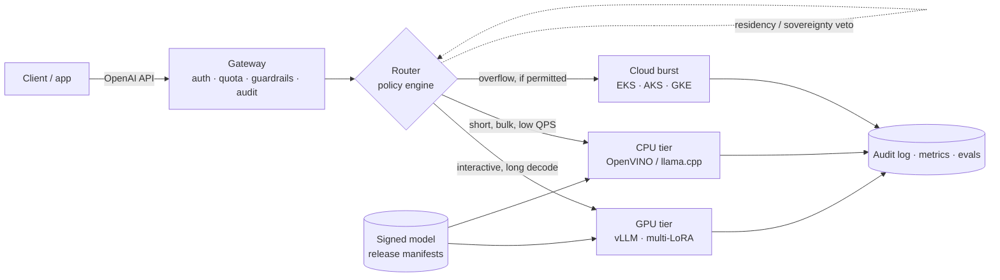

# SLM Serving Fabric

Private, provider-agnostic serving for fine-tuned small language models — a runnable
reference platform, not a slide deck.

**Status:** Phase 0 of 6 — GPU inference tier is live and measured.

---

## Thesis

A 1–8B model, fine-tuned on a narrow enterprise task and served with the right runtime
per compute tier, delivers most of the quality of a frontier model at a fraction of the
cost — provided the platform can decide, per request, **which model, which tier, and
which quantisation** still satisfies the SLO inside the customer's perimeter.

Most "private LLM" architectures stop at a single vLLM deployment behind an API key.
That is the easy 20%. The remaining 80% is:

- choosing between **GPU and CPU** on latency, cost and concurrency — not on vibes;
- keeping **tenants, data residency and air-gapped sites** from leaking into each other;
- shipping a **model release** through gates, canary, and rollback without a redeploy;
- proving **why** every request went where it went, to an auditor.

This repo builds that platform, and documents the decisions as reviewable ADRs.

---

## What is real, and what is modelled

An architecture document that blurs this line is worthless in review, so the repo keeps
the distinction explicit:

| Layer | Phase 0 status | Evidence |
|---|---|---|
| GPU tier (vLLM, AWQ W4A16, multi-LoRA capable) | **Measured** | `make smoke`, table below |
| Fine-tuned adapters | Planned (Phase 2) | — |
| CPU tier (OpenVINO / llama.cpp on Xeon/EPYC) | **Modelled** — calibrated simulator, no Xeon on this laptop | `src/tiersim` |
| Cloud burst tiers (EKS / AKS / GKE) | **Modelled** endpoints behind the same interface | `src/tiersim` |
| OpenShift / air-gapped deployment | **Static validation** — manifests render and pass policy checks; no cluster available | `deploy/openshift` |
| Router, governance, release pipeline | Planned (Phases 3–5) | — |

Numbers from a simulated tier are labelled `MODELLED` everywhere they appear.

---

## Architecture



The platform contract is deliberately portable: Kubernetes + Gateway API + OCI registry +
S3-compatible object storage + OIDC. **OpenShift is the reference substrate**; EKS, AKS and
GKE differ only in node pools, storage class, KMS and DNS.

---

## Quickstart

Requirements: Docker Desktop (WSL2 backend), an NVIDIA GPU with a working Windows driver,
Python 3.10+, ~12 GB free VRAM and ~15 GB disk.

```bash
make gpu-check     # NVIDIA GPU visible inside a container
make up            # pull runtime, download weights, wait for healthy
make smoke         # streaming TTFT, decode throughput, JSON validity
make logs          # follow the server
make down          # stop (model cache is kept)
```

The endpoint is OpenAI-compatible:

```bash
curl -s http://localhost:8010/v1/chat/completions \
  -H 'Content-Type: application/json' \
  -d '{"model":"slm-small","messages":[{"role":"user","content":"hello"}],"max_tokens":32}'
```

The host port defaults to 8010 (`VLLM_PORT` in `.env`) because 8000 is commonly
already taken on developer machines.

Clients address the alias `slm-small`, never a weights path. That indirection is what
lets a model release swap AWQ for a new adapter without touching application code.

---

## Measured on this machine

Host: RTX 4080 Laptop GPU, 12 GB VRAM · Docker 29.4 · vLLM `v0.33.0`

| Metric | Value |
|---|---|
| Model | Qwen3-4B-Instruct-2507, AWQ W4A16 via compressed-tensors |
| Weights revision | `b37d1cc` (pinned SHA) |
| Context / max sequences | 8,192 tokens · 16 |
| KV cache | 5.93 GiB → 43,136 tokens → 5.3× concurrent 8k requests |
| VRAM in use | 9,975 / 12,282 MiB |
| Engine init | 30.5 s (model load, profiling, CUDA graph capture) |
| Time to first token | 234 ms first request · **20 ms** median warm |
| Decode throughput | **128.5 tok/s** median, 5 runs of 80–96 tokens |
| Structured output | valid strict JSON on the extraction prompt |

```text
$ make smoke
endpoint  http://localhost:8010
models    ['slm-small']
ttft      0.243 s
decode    68.7 tok/s over 35 tokens
latency   0.753 s total
json      {"customer": "Acme", "product": "X200 pump", "sentiment": "negative"}
PASS
```

The 35-token run is slower than the 90-token median because fixed per-request overhead
dominates short generations; decode throughput is the metric that matters for tiering.
5.9 GiB of KV cache is deliberate headroom for multiple LoRA adapters in Phase 2.

*Note: numbers are from a laptop RTX 4080 (12 GB). They demonstrate the tier is real and
calibrate the cost model — they are not a capacity plan for datacentre GPUs.*

---

## Repository map

```
compose.yaml          GPU serving tier (pinned runtime + pinned weights)
Makefile              operational entry points
scripts/smoke.py      streaming smoke test; doubles as the CI gate
src/gateway/          OpenAI-compatible API, tenant auth, guardrails, audit
src/router/           policy engine: admissibility, tier scoring, breakers
src/tiersim/          calibrated CPU / cloud tier simulator
src/registry/         signed model release manifests
src/eval/             golden sets, deterministic checks, drift detection
deploy/openshift/     SCC, Route, ImageStream, GPU Operator, IDMS/ITMS
deploy/kustomize/     overlays: openshift, vanilla k8s, airgap
deploy/policies/      Kyverno / Gatekeeper admission policy
deploy/gitops/        Argo CD app-of-apps, Rollouts analysis
finetune/             QLoRA scripts producing adapter v1 / v2
bench/                load generator and recorded results
docs/adr/             architecture decision records
docs/signoff/         architecture review template and completed review
```

---

## Decisions taken in Phase 0

**Pinned everything.** The runtime is pinned to `vllm/vllm-openai:v0.33.0` and the weights
to a commit SHA, not `main`. A serving node is a reproducible artifact; `latest` means the
model can change under a running release without anyone noticing.

**AWQ INT4, not FP8.** The target GPU is Ada (sm_89), which has no FP8 tensor cores. FP8
would fall back to dequantise-on-the-fly and lose to INT4 on both latency and memory.

**Third-party quantisation is a recorded risk.** Qwen does not publish an official AWQ
build of the 2507 Instruct 4B, so Phase 0 pins a community AWQ artifact by revision. This
is acceptable for a reference build and unacceptable for regulated production — Phase 4
re-quantises in-house from official weights and records provenance per release. This is
ADR-0002 once the ADR series lands.

**Headroom is reserved on purpose.** 8k context and 16 concurrent sequences leave VRAM
for multiple LoRA adapters in Phase 2, rather than maxing out a single-model deployment.

**One tier per container, one alias per model.** Scaling, quotas and failure domains follow
the tier; routing and release management follow the alias.

---

## Roadmap

| Phase | Scope | Status |
|---|---|---|
| 0 | Scaffold, GPU passthrough, vLLM serving, smoke test | **Done** |
| 1 | Gateway, CPU tier simulator, metrics | Next |
| 2 | QLoRA adapters v1/v2, multi-LoRA hot loading | |
| 3 | Router policy engine, canary, audit trail | |
| 4 | Benchmarks, eval harness, cost model | |
| 5 | OpenShift / air-gap manifests, GitOps, admission policy | |
| 6 | ADRs, C4 diagrams, architecture sign-off pack | |

---

## Weights and licences

Base model: [Qwen3-4B-Instruct-2507](https://huggingface.co/Qwen/Qwen3-4B-Instruct-2507)
(Apache-2.0). AWQ build: `cyankiwi/Qwen3-4B-Instruct-2507-AWQ-4bit`, pinned by revision.
Runtime: vLLM (Apache-2.0). No model weights are vendored into this repository.
