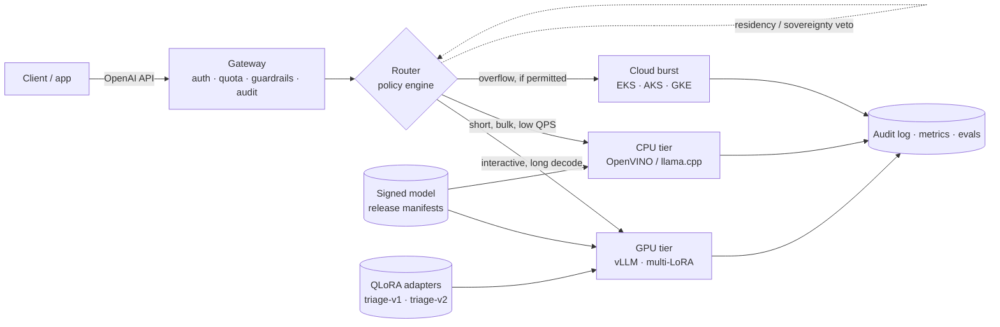

# SLM Serving Fabric

Private, provider-agnostic serving for fine-tuned small language models — a runnable
reference platform, not a slide deck.

**Status:** Phase 6 of 6 — GPU tier, gateway, simulated CPU and cloud tiers, observability,
two QLoRA adapters, a policy-driven router with canary, breakers and a hash-chained audit
trail, a benchmark harness, a golden-set release gate and an ownership cost model are live
and measured. The stack ships as Kustomize overlays for OpenShift, vanilla Kubernetes and
air-gapped installs, reconciled by Argo CD and enforced by Kyverno. Releases are now signed
manifests chained to the policy, adapters, gate artifact and rendered deployment, with C4
views and an architecture sign-off pack that states what is measured and what is not. The
vanilla overlay, Kyverno enforcement and Argo CD reconciliation were then exercised on a
kind cluster; OpenShift remains static validation. First-party images are now built and
published to GHCR by CI, and every workload image is pinned by digest in the signed release.

---

## Watch the explainer

A 75-second walkthrough, from the customer problem to the four decisions a private LLM
platform has to get right: tier routing, tenant isolation, release and audit.

https://github.com/user-attachments/assets/3dd2821f-45c3-4473-a361-46caeabf3b47

---

## Thesis

A 1–8B model, fine-tuned on a narrow enterprise task and served with the right runtime
per compute tier, delivers most of the quality of a frontier model at a fraction of the
cost — provided the platform can decide, per request, **which model, which tier, and
which quantisation** still satisfies the SLO inside the customer's perimeter.

Most "private LLM" architectures stop at a single vLLM deployment behind an API key.
That is the easy 20%. The remaining 80% is:

- choosing between **GPU and CPU** on latency, cost and concurrency — not on vibes;
- keeping **tenants, data residency and air-gapped sites** from leaking into each other;
- shipping a **model release** through gates, canary, and rollback without a redeploy;
- proving **why** every request went where it went, to an auditor.

This repo builds that platform, and documents the decisions as reviewable ADRs.

---

## What is real, and what is modelled

An architecture document that blurs this line is worthless in review, so the repo keeps
the distinction explicit:

| Layer | Status | Evidence |
|---|---|---|
| GPU tier (vLLM, AWQ W4A16, multi-LoRA capable) | **Measured** | `make smoke`, tables below |
| Fine-tuned adapters (QLoRA v1/v2, hot load / unload) | **Measured** | `make adapter-train`, `make adapter-smoke`, eval table below |
| Gateway (auth, quotas, streaming proxy, policy router, audit) | **Measured** | `make smoke-gateway` |
| Router (admission, canary, shadow, circuit breakers, reload) | **Measured** | `make smoke-policy`, outage drill below |
| Hash-chained audit + verification | **Measured** | `GET /v1/audit/verify` |
| Benchmarks (closed-loop, GPU + modelled tiers) | **Measured / MODELLED per run** | `make bench`, `bench/results/tier-comparison.json` |
| Release eval gate (24-ticket golden set, floors + drift) | **Measured** | `make eval-gate`, `src/eval/golden.jsonl` |
| Cost model (ownership TCO + modelled tiers) | **Measured throughput, stated assumptions** | `make cost`, `config/cost.yaml` |
| Observability (Prometheus + provisioned Grafana) | **Measured** | dashboard `slm-platform`, 7 panels |
| CPU tier (OpenVINO / llama.cpp on Xeon/EPYC) | **Modelled** — calibrated simulator, no Xeon on this laptop | `src/tiersim`, labelled `x-simulated: true` |
| Cloud burst tier (L4 profile) | **Modelled and wired** — a standby that residency usually excludes | `tiersim-cloud`, `x-simulated: true` |
| OpenShift / vanilla / air-gap deployment | **Vanilla verified on kind; OpenShift and air gap static** — 25 objects applied, gateway and both simulators running | `deploy/kustomize`, `make deploy-validate`, [A-17](docs/signoff/acceptance.md) |
| GitOps, release hooks and admission policy | **Admission and Argo verified on kind; hooks unrun** — Kyverno v1.19.2 denials and Argo v3.6.1 self-heal observed | `deploy/gitops`, `deploy/policies`, [A-20](docs/signoff/acceptance.md), [A-21](docs/signoff/acceptance.md) |
| Signed release manifest (Ed25519, canonical JSON, drift checks) | **Measured** | `make release`, `make release-check`, `release/slm-0.5.0.json` |
| Image supply (first-party build → GHCR → digest pin) | **Measured (hosted CI + registry)** — images run `41935648483` published three public packages; all four workload images render as `@sha256:`; no cluster pulled them yet | `.github/workflows/images.yml`, [A-22](docs/signoff/acceptance.md) |
| C4 views, threat model, acceptance and sign-off pack | **Documented** — review artifacts, not runtime evidence | `docs/architecture/c4.md`, `docs/signoff/` |
| CI pipeline (tests + both validators) | **Verified** — GitHub Actions run `41875084383`, all steps green | `.github/workflows/ci.yml` |

Numbers from a simulated tier are labelled `MODELLED` everywhere they appear.

---

## Architecture



The platform contract is deliberately portable: Kubernetes + Gateway API + OCI registry +
S3-compatible object storage + OIDC. **OpenShift is the reference substrate**; EKS, AKS and
GKE differ only in node pools, storage class, KMS and DNS.

---

## Start here (first run)

You do not need to know the architecture to get it running. You need Docker and, for the
real model, one NVIDIA GPU. Everything is copy-paste; `make` is a convenience, not a
requirement.

| You need | Why | Check |
|---|---|---|
| Docker Desktop or Docker Engine with Compose v2 | runs every service | `docker compose version` |
| An NVIDIA GPU with ~12 GB VRAM and a working driver | serves the 4B AWQ model | `nvidia-smi` |
| ~20 GB free disk and 10–20 minutes on first start | image builds and model download | `df -h` |
| Python 3.10+ | preflight and smoke scripts | `python --version` |

No GPU? You can still run the unit tests and the static deployment checks:
`make test` and `make deploy-validate` (or the raw commands in the troubleshooting table).
The full stack will not start, because the gateway waits for the GPU tier to be healthy.

**1. Get the code**

```bash
git clone https://github.com/mahi80/SLM-FIne-Tuned-Inference.git
cd SLM-FIne-Tuned-Inference
```

**2. Check the machine first**

```bash
python scripts/doctor.py
```

This installs nothing and prints only PASS/WARN/FAIL lines. It checks Docker and Compose,
the NVIDIA driver and Docker runtime, VRAM, free disk, the six host ports, the env files and
whether `compose.yaml` validates. If `.env` or `config/tenants.yaml` is missing:

```bash
python scripts/doctor.py --fix   # creates both from the committed examples
```

The tenant keys in the example are local demo keys. Replace them in
`config/tenants.yaml` (gitignored) before the gateway is reachable from anywhere else.

**3. Start it**

```bash
make up
```

No `make` on Windows Git Bash? Use `docker compose up -d --wait`. The first run builds the
gateway and simulator images and downloads the pinned weights; vLLM allows up to 10 minutes
to become healthy.

**4. See that it works**

```bash
make ps                # every service should be healthy
make health            # {"status":"ok","aliases":4,"policy_version":"...","breakers":{...}}
make smoke-gateway     # auth, GPU streaming, simulated CPU tier, metrics
```

Then send one request:

```bash
curl -s http://localhost:8020/v1/chat/completions \
  -H 'Authorization: Bearer dev-acme-key' \
  -H 'Content-Type: application/json' \
  -d '{"model":"slm-small","messages":[{"role":"user","content":"hello"}],"max_tokens":32}'
```

**5. Look at it**

| Service | URL | Notes |
|---|---|---|
| Grafana | http://localhost:3001 | `admin` / `admin`, dashboard **SLM Serving Fabric** |
| Prometheus | http://localhost:9090 | scrapes gateway, both simulators and vLLM |
| Gateway (OpenAI API) | http://localhost:8020 | `Authorization: Bearer dev-acme-key` |
| GPU tier | http://localhost:8010 | direct; bypasses the gateway |
| CPU tier (simulated) | http://localhost:8011 | direct; responses carry `x-simulated: true` |
| Cloud tier (simulated) | http://localhost:8012 | L4 profile; a residency-gated standby |

The GPU tier is real. The CPU and cloud tiers are calibrated simulators and label every
response `x-simulated: true`; their numbers are MODELLED, not measured.

**6. Stop**

```bash
make down     # or: docker compose down
```

The model cache and dashboards are kept. `make clean` also deletes those volumes.

### Troubleshooting

| Symptom | What to do |
|---|---|
| `make: command not found` | Use the raw command shown beside each step, e.g. `docker compose up -d --wait`. |
| `doctor` says the Docker daemon is not running | Start Docker Desktop and wait for “Engine running”, then rerun. |
| No NVIDIA GPU / Docker has no nvidia runtime | Install the NVIDIA driver and enable GPU support in Docker Desktop (or `nvidia-container-toolkit` on Linux). `make gpu-check` must print `nvidia-smi` output. Without a GPU, run only the tests and validators. |
| A port is already in use | Change the matching `*_PORT` in `.env` (for example `GATEWAY_PORT=8120`), then `make up`. |
| Gateway is unhealthy | `docker compose logs -f vllm-gpu`; first start can take 10 minutes for weights. Check disk space too. |
| `401` from the gateway | Use the key from your local `config/tenants.yaml` (`dev-acme-key` is the example). |
| Want a clean slate | `make down` keeps data; `make clean` deletes containers and volumes, including the model cache. |
| Nothing works | `python scripts/doctor.py` again and read the FAIL hints; they name the exact fix. |

### Everyday commands

```bash
make doctor        # preflight: Docker, GPU, ports, env files
make up            # start and wait until healthy
make logs          # follow all services
make smoke         # GPU tier directly
make smoke-policy  # admission, residency veto, canary stability, audit chain
make test          # 112 unit tests, no GPU or cluster needed
make adapter-train # QLoRA adapters v1/v2, then hot-load them (~25 min of GPU)
make bench         # tier benchmark matrix
make eval-gate     # golden-set release gate
make cost          # ownership cost per 1M output tokens
make release-check # signed manifest = policy = adapters = overlays = compose
make signoff       # tests, both validators, signature verify; writes evidence.json
```

`slm-small` prefers the GPU tier and has CPU and cloud standbys; `slm-small-cpu` pins the
simulated CPU tier; `slm-triage` is a release alias (v1 primary, v2 canary at 50% sticky per
tenant) and `slm-triage-v2` pins v2. Clients address an alias, never a weights path or a
tier — that indirection is what lets the router honour residency and what lets a release
swap weights without touching application code.

Host ports are configurable in `.env`; 8000 is deliberately avoided because it is commonly
already taken on developer machines.

---

## Kubernetes and OpenShift

The compose stack is the developer loop. The cluster path keeps the same
`config/policy.yaml` and the same Service names, so a routing rule tested locally resolves
to a real Service after deployment — and the validator fails the build if it does not.

```bash
make deploy-images   # optional: build local copies; the cluster pulls the CI-published digests
make deploy-validate # render all three overlays and check the invariants (no cluster needed)
make deploy-render   # write deploy/rendered/{openshift,vanilla,airgap}.yaml
make deploy-secret   # create slm-tenants from the gitignored config/tenants.yaml
```

| Overlay | What it adds | Target |
|---|---|---|
| `openshift` | Route with edge TLS and a 300s timeout, ServiceMonitor, monitoring scrape policy, release hooks | Reference substrate |
| `vanilla` | nginx Ingress, explicit UID/fsGroup 1001, no hooks | EKS / AKS / GKE / kind |
| `airgap` | OpenShift shape plus offline Hugging Face env and no model-download egress | Disconnected site |

The manifests resolve first-party images from `ghcr.io/mahi80/*` and vLLM from Docker Hub,
each pinned by digest. The GHCR packages are public; for a private mirror, retag the same
digests into the registry your cluster pulls from (the air-gap overlay has an `oc image
mirror` list). The kustomization reads `config/policy.yaml` from outside its own tree, so
Argo's repo server needs the kustomize load-restrictor flag. Argo CD v3 removed the
per-Application `spec.source.kustomize.buildOptions` field and rejects an Application that
carries it, so set the flag once for the repository:

```bash
kubectl -n argocd patch configmap argocd-cm --type merge -p \
  '{"data":{"kustomize.buildOptions":"--load-restrictor LoadRestrictionsNone"}}'
kubectl -n argocd rollout restart deploy/argocd-repo-server
```

Then reconcile:

```bash
kubectl apply -f deploy/gitops/argocd/project.yaml
kubectl apply -f deploy/gitops/argocd/app-of-apps.yaml
```

Prerequisites are Argo CD, Kyverno, the NVIDIA GPU Operator and either Prometheus Operator
or OpenShift user-workload monitoring. Seed the `slm-adapters` PVC from `make adapter-train`
before the first sync; the loader hook declares `triage-v1`/`triage-v2` and fails the sync
if either is absent. The root app syncs admission policy (`slm-policies`, wave 0) before
the platform (`slm-platform`, wave 10); the platform's PostSync hooks then load the
adapters into vLLM and run the golden-set gate against the served adapter. A failed gate
leaves the application failed and un-promoted.

```text
$ python tools/validate_deploy.py
OK   openshift: 32 objects
OK   vanilla: 25 objects
OK   airgap: 31 objects
```

The validator is the review artifact. It re-renders the overlays and checks:

- every candidate URL in `config/policy.yaml` resolves to a Service and port in the
  rendered set, and the policy ConfigMap is identical to the file on disk;
- the vLLM image and model revision are the Phase 0 pins, and multi-LoRA is enabled;
- restricted security contexts, resource requests/limits and readiness probes on every
  workload, with vLLM the single documented exception to a read-only root filesystem;
- no Secret material, no host namespaces, no `latest` tags, and a single `Recreate`
  gateway because quota, breaker and audit state are in-process;
- the overlay actually exposes what it claims: a Route or Ingress for the gateway, a
  ServiceMonitor and scrape policy on OpenShift, offline env in the air gap.

**Air gap.** Mirror the images with `deploy/openshift/airgap/mirror.sh`, apply the
cluster-scoped `IDMS`/`ITMS` objects with `kubectl apply -k deploy/openshift/airgap`, point
`deploy/gitops/apps/platform.yaml` at `overlays/airgap`, and seed `slm-model-cache` from the
mirrored weights before first start. The application manifests do not change.

**Limits, stated.** The vanilla overlay ran on a kind v0.33.0 cluster: 25 objects applied,
gateway and both simulators answering, Kyverno v1.19.2 denying two synthetic pods, and Argo
CD v3.6.1 self-healing a drifted policy. That pass also found a real defect static review
missed (a `subPath` mount nested inside a read-only ConfigMap mount), now fixed and checked
by the validator. What kind does not cover: OpenShift SCC/Route/ServiceMonitor, the
release PostSync hooks, the air-gap mirror, NetworkPolicy enforcement (kindnet does not
enforce it) and an ingress controller (the Ingress object has no backing controller). The
GPU tier could not schedule, so the platform Application stops at its wave-3 health gate by
design. Every workload image is pinned by digest: the three first-party images come from
public GHCR packages built by CI, and the upstream vLLM digest is recorded in the signed
manifest. No cluster has pulled the GHCR images yet, so their registry-to-kubelet path is
still unproven. PVCs rely on the cluster default storage class, and the gateway is
deliberately one replica. The full rationale is in
[ADR-0006](docs/adr/ADR-0006-deployment-gitops.md); the observed rows are A-17 to A-22 in
the [acceptance pack](docs/signoff/acceptance.md).

---

## Signed releases and the review pack

A release here is a manifest, not a git tag. `make release` writes
`release/slm-0.5.0.json` — canonical JSON that pins the base model revision, the digest of
every adapter file, the image digests, the policy version and hash, the gate artifact and
its verdict, the benchmark and cost evidence, and the commit the manifest was built from. It
refuses to build if the release gate did not pass.

```bash
make release-key   # once per environment: generate an Ed25519 key pair (private key gitignored)
make release       # build, sign, verify
make release-check # signed manifest = rendered overlays = compose pins
```

```text
$ make release-check
note vanilla: adapter promotion and the in-cluster gate are operator-run; the overlay deliberately carries no PostSync hooks
OK   release slm-0.5.0 = signed manifest = 3 overlay(s)
```

The check re-renders all three overlays and fails on drift: a changed policy file, a golden
set edited after the gate ran, a re-trained adapter, a stale gate artifact, a compose tag
that no longer matches the manifest. Each of those is a silent-release bug that a tag would
not catch, and each has a deliberate test.

```text
$ make release-verify
OK   release/slm-0.5.0.json: signature verified
release  slm-0.5.0 gate=PASS exact=0.833
```

Signing is Ed25519 over the canonical bytes, verified offline with the committed public
key, which is the reason it was chosen over cosign for air-gapped sites ([ADR-0007](docs/adr/ADR-0007-signed-releases.md)).
It proves the manifest bytes were not altered and records the gate that authorised them.
It does **not** prove the weights match the revision, nor who signed: that needs the key in
an HSM/KMS and an attestation that the published image was built from this tree, both named
as conditions in the acceptance record.

The review pack answers the questions a reviewer actually asks, in order:

| Document | Question it answers |
|---|---|
| [requirements.md](docs/signoff/requirements.md) | What was asked, requirement by requirement, and which ones are not met |
| [c4.md](docs/architecture/c4.md) | What the system is: L1–L4 views, runtime sequence, trust boundaries |
| [acceptance.md](docs/signoff/acceptance.md) | What was verified (A-01…A-22), what was not (N-01…N-11), and the conditions (C-01…C-10) |
| [threat-model.md](docs/signoff/threat-model.md) | What can go wrong, by asset, actor and entry point |
| [risks.md](docs/signoff/risks.md) | Which risks are accepted, with anchors into the code |
| [operations.md](docs/signoff/operations.md) | How it runs: SLOs, alerts, runbooks, backups |
| [release-process.md](docs/signoff/release-process.md) | Who builds, signs, promotes and rolls back |
| [evidence.json](docs/signoff/evidence.json) | Generated: test counts, signature status and artifact hashes |

The verdict is **accepted as a reference platform with conditions** — not a production
acceptance. CPU and cloud throughput are modelled, OpenShift/Kyverno/Argo behaviour is
statically validated rather than observed, and there is no multi-replica gateway. Those are
stated at the top of the record rather than buried.

---

## Measured on this machine

Host: RTX 4080 Laptop GPU, 12 GB VRAM · Docker 29.4 · vLLM `v0.33.0`

| Metric | Value |
|---|---|
| Model | Qwen3-4B-Instruct-2507, AWQ W4A16 via compressed-tensors |
| Weights revision | `b37d1cc` (pinned SHA) |
| Context / max sequences | 8,192 tokens · 16 |
| KV cache | 5.93 GiB → 43,136 tokens → 5.3× concurrent 8k requests |
| VRAM in use | 9,975 / 12,282 MiB |
| VRAM with both LoRA adapters | 10,563 / 12,282 MiB |
| Engine init | 30.5 s (model load, profiling, CUDA graph capture) |
| Time to first token | 234 ms first request · **20 ms** median warm · 53 ms at 12 clients |
| Decode throughput | **125.5 tok/s** single stream · **1,123 tok/s** aggregate at 12 clients |
| Structured output | valid strict JSON on the extraction prompt |

```text
$ make smoke
endpoint  http://localhost:8010
models    ['slm-small']
ttft      0.243 s
decode    68.7 tok/s over 35 tokens
latency   0.753 s total
json      {"customer": "Acme", "product": "X200 pump", "sentiment": "negative"}
PASS
```

The 35-token run is slower than the 90-token median because fixed per-request overhead
dominates short generations; decode throughput is the metric that matters for tiering.
5.9 GiB of KV cache is deliberate headroom for multiple LoRA adapters in Phase 2.

*Note: numbers are from a laptop RTX 4080 (12 GB). They demonstrate the tier is real and
calibrate the cost model — they are not a capacity plan for datacentre GPUs.*

### Tier comparison through the gateway

Same prompt, 90-token budget, median of three streaming requests:

| Tier | TTFT | Total | Throughput | Cost / 1M output tokens |
|---|---|---|---|---|
| GPU (measured) | 33 ms | **0.74 s** | ~122 tok/s | not metered locally |
| CPU (MODELLED) | 93 ms | **5.77 s** | ~16 tok/s | $8.80 |
| GPU reference profile (MODELLED) | — | — | ~500 tok/s aggregate | $0.33 |

Queueing is real, not decorative: 12 concurrent requests against 8 CPU slots produced a
median of 1.32 s and a maximum of 2.61 s — the second half genuinely waited for a slot.

The 7.8x latency gap at identical output length is the routing problem in one table. It is
also why CPU is not a "cheap GPU": per output token it is roughly 25x more expensive here,
and wins only against an already-idle GPU, a latency-tolerant deadline, or no GPU at all.

### Failover is proven, not asserted

With the GPU container stopped, `slm-small` stayed at **200**. The first requests failed over
at the transport level (`x-fallback: true`); after three failures the breaker opened and the
router selected the standby directly. Residency decided *which* standby:

| Tenant | Region / class | Served by | Why |
|---|---|---|---|
| acme | eu / confidential | CPU tier | `cloud-us: region-veto`; EU data stays on an owned tier |
| globex | us / internal | Cloud tier (MODELLED) | US data, cloud allowed, cheapest admissible standby |

The GPU was then restarted, adapters were hot-loaded again and the breaker returned to
closed on the next successful request. The breaker state and the full admission trace are in
[Routing is a policy, not a table](#routing-is-a-policy-not-a-table).

---

## Gateway contract

Every response carries its routing decision:

| Header | Meaning |
|---|---|
| `x-request-id` | Correlates the audit record, gateway metrics and upstream logs |
| `x-route-alias` | The alias the client asked for |
| `x-tier` | `gpu`, `cpu` or `cloud` |
| `x-route-reason` | `policy:<primary\|canary\|standby>:<candidate>[:fallback]` |
| `x-policy-version` | Version of the policy file that decided |
| `x-fallback` | `true` when the chosen candidate failed and a later attempt served |
| `x-canary` | `true` when the served candidate came from the canary slice |
| `x-model-version` | The model version that actually answered |
| `x-shadow` | Candidate that received a shadow copy, when one was sampled |
| `x-simulated` | Present and `true` only for modelled tiers |

Working today: bearer auth with constant-time key comparison, per-tenant sliding-window
RPM limits (429 with `Retry-After`), admission and scoring per request, deterministic
canary, shadow sampling, per-candidate circuit breakers, unbuffered streaming pass-through,
usage accounting from upstream, hash-chained audit records, live policy reload, decision
explain and audit verification.

Deliberately still absent: a shared quota counter for multi-replica gateways (the limiter is
in-memory and explicitly single-replica), and quality-aware scoring that uses eval results
rather than static cost and priority. Pretending otherwise would be the kind of gap that
fails an architecture review.

---

## Routing is a policy, not a table

`config/policy.yaml` is versioned data. An alias is what a client asks for; each candidate
is a place the request can run: tier, backend, region, sovereignty, context budget,
priority, cost and model version. The router **admits before it scores**, so a cheap tier
never wins a request it is not entitled to serve.

Admission, in order:

1. the tenant's alias allowlist;
2. the tenant's tier allowlist;
3. cloud permission (`allow_cloud`);
4. region match against `serves_regions`;
5. data class vs sovereignty — `confidential` and `restricted` never leave owned tiers;
6. context budget — estimated prompt + `max_tokens` must fit `max_context`;
7. breaker state — an open candidate is not a route.

Only admissible candidates are considered. The primary wins by default; otherwise the
canary slice is applied; otherwise the best standby by
`priority*100 + cost_per_1k_out*1000 + failure_rate*50`. Every excluded candidate carries a
reason (`region-veto`, `cloud-denied`, `sovereignty-veto`, `context-exceeded`,
`breaker-open`, `alias-denied`, …) into the explain endpoint and the audit record.

### Canary and shadow

`slm-triage` keeps v1 as primary and sends v2 to a deterministic 50% slice:
`blake2b("canary:slm-triage", tenant-or-request) mod 100`. Sticky per tenant, so a tenant
does not flip versions between requests; no shared counter is needed and a gateway restart
does not reshuffle the assignment. Measured buckets here: **acme 67 (v1)**, **globex 37
(v2)**.

A shadow copy (`slm-triage` → v2, 5%, `max_tokens` capped at 64) is sent for primary
traffic and discarded; it is audited as a separate `shadow` record and counted by
`gateway_shadow_requests_total`. The header `x-shadow` names the target.

```bash
# promote v2 to 100%, then roll back with a file edit and a reload
curl -s -X POST http://localhost:8020/v1/policy/reload \
  -H 'Authorization: Bearer dev-acme-key'
```

Reload is atomic: an invalid YAML file returns **422** and the previous policy keeps
serving. Measured rollback: setting the canary to 0% moved globex from
`policy:canary:v2` to `policy:primary:v1` on the next request, with no restart.

### Circuit breakers

Health is tracked per `alias:candidate`, not per backend, so one alias's failure does not
blind another. Three failures inside 60 s open the breaker for 20 s; one probe is admitted
in half-open; success closes it, failure reopens it. Connection errors, timeouts and 5xx
responses count as failures; 4xx does not. When the chosen candidate fails, the gateway
walks the ordered attempt list built from the same admission pass — never an inadmissible
candidate.

### Measured outage drill

With the GPU container stopped:

| Request | Tenant | Tier | `x-route-reason` | `x-fallback` |
|---|---|---|---|---|
| 1–3 | acme (eu) | cpu | `policy:primary:cpu:fallback` | `true` |
| 4 | acme (eu) | cpu | `policy:standby:cpu` | `false` |
| 1–4 | globex (us) | cloud | `policy:standby:cloud-us` | `false` |

The breaker is shared by alias, so acme's three failures opened `slm-small:gpu` for globex
too. The audit record for acme carries `vetoed: ["cloud-us:region-veto"]`; globex has no
such veto and the cloud candidate wins on score. This is the difference between a fallback
chain and a policy: the fallback for EU confidential traffic is the CPU tier, even though
the cloud tier is cheaper and faster.

Recovery is equally boring: start the GPU, hot-load the adapters, send one request. The
half-open probe succeeds and the breaker returns to closed.

### The audit trail

`logs/audit.jsonl` gets one record per inference and one per shadow request. Each record
commits to its predecessor:

```text
hash = sha256(canonical_json(record without hash))
```

so editing, removing or reordering a record breaks verification from that point on. The
gateway recovers the head on startup, drops a torn final line (crash between write and
newline), and refuses to start if anything earlier fails verification. `GET
/v1/audit/verify` recomputes the chain:

```json
{"ok": true, "records": 65, "last_seq": 65,
 "last_hash": "cb8e9565f625e4fee35272587afe0e4fc71aa853b7a023318128170bbd82d3dc"}
```

This is tamper **evidence**, not prevention: a writer with filesystem access can rewrite the
whole chain. Production must ship the head hash to a separate sink with object-lock or
append-only retention. Audit writes are fsync'd per record; a disk error is logged loudly
and does not fail the request, which is a deliberate availability-over-evidence trade-off
for this reference build, not a compliance posture.

### Policy endpoints

| Endpoint | Role | Purpose |
|---|---|---|
| `GET /v1/policy` | admin | Active policy, breakers and their state |
| `POST /v1/policy/explain` | tenant | Full admission trace for a hypothetical request |
| `POST /v1/policy/reload` | admin | Validate and swap the file; 422 keeps the old policy |
| `GET /v1/audit/verify` | admin | Recompute the hash chain |

```text
$ make smoke-policy
health    4 aliases, policy 2026-11-04.1
policy    4 aliases, breaker {'failures': 3, 'window_s': 60.0, 'open_s': 20.0}
admission acme/eu   chosen=gpu vetoed={'cloud-us': 'region-veto'}
admission globex    refused=alias-denied
canary    globex bucket=37 percent=50 decision=canary chosen=v2
audit     ok, 65 records, head cb8e9565f625e4f...
auth      non-admin policy read is 403
PASS
```

New metrics: `gateway_route_decisions_total`, `gateway_policy_refusals_total`,
`gateway_canary_requests_total`, `gateway_shadow_requests_total`,
`gateway_breaker_state` (0 closed, 1 half-open, 2 open), `gateway_policy_reloads_total`.

The full design rationale is in [ADR-0004](docs/adr/ADR-0004-policy-router.md).

---

## Fine-tuning: two adapters, one contract

The narrow task is **support-ticket triage** for an industrial tenant. The model must emit
strict JSON against a fixed taxonomy and a severity rubric — exactly the kind of contract a
general model drifts on:

```json
{"category": "technical", "priority": "P2", "sentiment": "negative",
 "escalate": true, "product": "X200 pump", "summary": "Line stopped at the north plant"}
```

`finetune/prompt.py` holds the system prompt, schema and rubric that training, evaluation
and callers share. Violating the schema is a bug; guessing a different taxonomy is a bigger
one.

**Data is generated, not scraped.** `finetune/dataset.py` builds 25 clean scenarios and 18
adversarial ones (sarcasm, conflicting urgency, multi-issue, missing model number, typos,
mixed language, angry-but-trivial) with labels from the scenario definition. Splits:

| Split | Rows | Content |
|---|---|---|
| `train-v1` | 320 | clean scenarios, first two paraphrases |
| `train-v2` | 336 | 240 clean + 96 adversarial |
| `eval` | 200 | 80 clean + 80 adversarial paraphrases + 40 tickets from four families never trained on |

**Training:** QLoRA (4-bit NF4, bf16 compute) on the official BF16 base
(`Qwen/Qwen3-4B-Instruct-2507`, pinned SHA), LoRA r=16 / α=32 / dropout 0.05 on all linear
layers. 33.0 M trainable parameters (0.81%). One adapter takes 320–336 steps, 13–15 minutes
on the RTX 4080, with the GPU tier stopped.

**Serving:** the adapter runs on the **AWQ base** via multi-LoRA, not a merged checkpoint.
This was verified before training: a probe adapter loaded onto the compressed-tensors AWQ
model and served under its own name, which is why `--enable-lora` is safe here. See
[ADR-0003](docs/adr/ADR-0003-adapters.md).

### Held-out results

200 tickets, temperature 0. "Exact" means category, priority, sentiment, escalate and
product all correct; strict JSON is `json.loads` of the raw answer with no trimming.

| Model | Strict JSON | Schema | Exact labels | Category | Priority | Sentiment | Escalate | Product | Clean | Hard | Held-out |
|---|---|---|---|---|---|---|---|---|---|---|---|
| base `slm-small` | 100% | 99.0% | **19.5%** | 80.0% | 70.0% | 81.0% | 76.0% | 38.0% | 23.7% | 15.0% | 20.0% |
| adapter v1 | 100% | 99.0% | **73.5%** | 98.5% | 85.0% | 86.5% | 93.0% | 96.0% | 77.5% | 57.5% | 97.5% |
| adapter v2 | 100% | 100% | **79.0%** | 97.0% | 100% | 86.0% | 93.0% | 97.0% | 85.0% | 76.2% | 72.5% |

- The base model writes valid JSON but invents taxonomy (`"category": "security"`,
  `"feature request"`) and misses product extraction 62% of the time. Fine-tuning buys the
  contract, not just the syntax.
- v1 is clean-data-only: strong on easy tickets, **57.5%** on adversarial input, and it
  reads sarcasm as positive sentiment.
- v2 is trained on clean + adversarial data: **76.2%** on the hard slice, 100% schema, and
  it handles the sarcasm case correctly. Its held-out dip is concentrated in two paraphrases
  whose generated labels are genuinely arguable, not in structure.
- Training loss fell below `1e-5` within two epochs in both runs, i.e. it memorised the
  templates. Promotion is therefore decided by the held-out eval, never by loss.

```text
$ make adapter-smoke
gateway   http://localhost:8020
models    ['slm-small', 'slm-small-cpu', 'slm-triage', 'slm-triage-v2']
sarcasm         base=P2/positive v1=P2/positive v2=P2/negative
feature-request base=P4/positive v1=P4/positive v2=P4/positive
calm-outage     base=P2/neutral v1=P2/negative v2=P2/neutral
PASS
```

### Promotion and rollback without a redeploy

Adapters are loaded through vLLM's control API and addressed as model names:

```bash
curl -s -X POST http://localhost:8010/v1/load_lora_adapter \
  -H 'Content-Type: application/json' \
  -d '{"lora_name":"triage-v2","lora_path":"/adapters/triage-v2"}'

curl -s -X POST http://localhost:8010/v1/unload_lora_adapter \
  -H 'Content-Type: application/json' -d '{"lora_name":"triage-v2"}'
```

Rollback was exercised end to end: after unload, `slm-triage-v2` returns **404** while
`slm-triage` keeps serving; reload restores **200**. Both adapters together add ~590 MiB of
VRAM (9,975 → 10,563 of 12,282 MiB). Adapter weights are build artifacts, git-ignored and
reproduced by `make adapter-train`; `training.json` records data, base revision,
hyper-parameters and the loss curve.

---

## Benchmarks, release gates and cost

Phase 3 made every routing decision explainable. Phase 4 makes the three claims a reviewer
would otherwise have to take on faith measurable: **how fast the tier is under load**, **whether
a release is good enough to promote**, and **what the owned GPU costs per token**.

### Benchmark method

Closed-loop, fixed concurrency: each worker holds one request in flight, so `c=12` means
twelve simultaneous clients, not a batch size. Two warm-up requests per level, then 20
measured requests (8 for the CPU profile), streaming with usage. Percentiles are nearest-rank,
so a p95 is an observed request, not an interpolation. Every run records its concurrency and
its source: a response carrying `x-simulated: true` is labelled **MODELLED** from the
response, not from the config. Same prompt, 64 output tokens.

```text
$ make bench
| Target | Source | c | Req/s | Output tok/s | TTFT p50 | Total p50 | Errors |
|---|---|---:|---:|---:|---:|---:|---:|
| gpu-direct c=1 | measured | 1 | 1.96 | 125.5 | 20 ms | 509 ms | 0 |
| gpu-direct c=4 | measured | 4 | 7.58 | 484.8 | 27 ms | 524 ms | 0 |
| gpu-direct c=12 | measured | 12 | 17.55 | 1123.2 | 53 ms | 569 ms | 0 |
| adapter-v2 c=1 | measured | 1 | 1.75 | 101.6 | 28 ms | 570 ms | 0 |
| adapter-v2 c=12 | measured | 12 | 14.67 | 850.9 | 128 ms | 683 ms | 0 |
| cloud-sim c=12 | MODELLED | 12 | 12.32 | 788.4 | 30 ms | 810 ms | 0 |
| cpu-sim c=12 | MODELLED | 12 | 1.91 | 122.2 | 121 ms | 4185 ms | 0 |
```

Reading it: the GPU scales **9x** from one to twelve clients while p50 total latency moves
only 509 → 569 ms. The adapter costs 15–25% of aggregate throughput, which is the price of
the contract it enforces. The CPU profile saturates at ~122 tok/s — it is a deadline tier,
not a cheap GPU — and its 4.2 s total latency is the routing problem in one number. The
simulated cloud tier is modelled, not measured; it exists so residency rules can veto or
permit a real third candidate.

### The release gate

A benchmark says how fast a model is; it says nothing about whether its labels are right.
The gate scores an alias against a **hand-written 24-ticket golden set** — eight clean,
eight adversarial and eight held-out tickets, new wording, labels taken from the rubric in
`finetune/prompt.py`, not from a model. It then applies absolute floors and drift against a
recorded baseline. Both must pass.

| Model | Strict JSON | Schema | Exact | Clean | Hard | Held-out | Gate |
|---|---:|---:|---:|---:|---:|---:|---|
| base `slm-small` | 100% | 100% | **4.2%** | 0.0% | 0.0% | 12.5% | fails floors |
| adapter v1 | 100% | 91.7% | **75.0%** | 100% | 62.5% | 62.5% | fails schema floor |
| adapter v2 | 100% | 100% | **83.3%** | 87.5% | 100% | 62.5% | **PASS** |

```text
$ make eval-gate
gate slm-triage-v2: PASS
  ok   exact_labels     actual=0.833 limit=0.7
  ok   slice:held-out   actual=0.625 limit=0.5
  ok   drift:exact_labels actual=0.833 limit=0.783  baseline 83.3%
```

v2's four remaining disagreements are real label errors, not schema errors: a thank-you read
as P3, a refund chase where the word "escalate" pulled `escalate` true, a licence transfer
read as cancellation, and a two-site outage read as P2 instead of P1. They are recorded with
the answer the model gave, so a reviewer can disagree with the label rather than guess at it.
`make eval-baseline` records the current release; `make eval-gate` then fails on a drop of
more than 5 points in exact labels or 10 points in any field.

### What the GPU actually costs

The policy prices CPU and cloud per token because those tiers send a bill. The owned GPU has
`cost_per_1k_out: 0.0` because its cost is capacity that was bought. `src/cost` converts
ownership into the same unit: capex over 36 months, 180 W at PUE 1.4 and $0.18/kWh, 15% ops,
and the **measured aggregate throughput** from `bench/results/tier-comparison.json`.

| Tier | Source | $/1M output (capacity) | $/1M at 20k/day | $/request | $/month | p50 total / TTFT |
|---|---|---:|---:|---:|---:|---:|
| owned GPU, 35% util | measured | **$0.117** | **$2.243** | $0.000202 | **$121.11** | 509 / 20 ms |
| cloud L4 profile | MODELLED | $0.797 | $0.797 | $0.000072 | $43.02 | 785 / 25 ms |
| CPU Xeon profile | MODELLED | $15.80 | $15.80 | $0.001422 | $853.20 | 4141 / 116 ms |

The distinction between the two GPU columns is the point: at 35% utilisation and full
capacity the node is cheap per token, but a 20k-request/day workload uses only about 2% of
its capacity, so the fixed bill is spread over few tokens. Break-even against the cloud
profile is **56,069 requests/day** (2,839 against CPU), inside the node's ~1.08M
request/day full capacity. Below that volume, cloud is cheaper; above it, owning the GPU
wins — and the model states the assumptions rather than hiding them.

Full methodology and limits are in [ADR-0005](docs/adr/ADR-0005-benchmarks-eval-cost.md).

---

## Repository map

```
compose.yaml                     the whole platform: tiers, gateway, observability
Makefile                         operational entry points
config/policy.yaml               versioned routing policy: aliases, candidates, canary
config/bench.yaml                benchmark targets, concurrency levels and prompt
config/eval-gates.yaml           release floors and drift allowances
config/cost.yaml                 ownership assumptions: capex, power, utilisation, workload
config/release.yaml              release identity: model pin, images, adapters, gate, evidence
config/tenants.example.yaml      tenant keys, quotas, region, data class; tenants.yaml is gitignored
scripts/smoke.py                 GPU tier smoke test
scripts/smoke_gateway.py         end-to-end test through the gateway, all tiers
scripts/smoke_policy.py          admission, residency, canary stability, audit chain
scripts/smoke_adapters.py        adapter aliases and contract check through the gateway
scripts/load_adapters.py         runtime load of every adapter into vLLM
tests/                           router, eval, cost, deployment and release unit tests (stdlib unittest)
.github/workflows/ci.yml         tests, deployment validator and release chain on every push
docker/                          gateway, simulator, QLoRA training and eval images
src/gateway/                     OpenAI-compatible API, auth, quotas, proxy, policy use, audit
src/router/                      policy model, admission, canary, breakers, hash-chained audit
src/tiersim/                     calibrated CPU / cloud tier simulator
src/registry/                    signed release manifests: canonical JSON, Ed25519, drift checks
src/bench/                       closed-loop load generator and report rendering
src/eval/                        golden-set scoring, floors and drift gate
src/cost/                        ownership TCO, utilisation sweep and break-even
deploy/observability/grafana/    provisioned datasource and dashboard
deploy/kustomize/                base, openshift/vanilla/airgap overlays, shared components
deploy/openshift/airgap/         IDMS/ITMS, mirrored image list and mirror script
deploy/policies/                 Kyverno ClusterPolicies enforced at admission
deploy/gitops/                   Argo CD project, app-of-apps and child Applications
release/                         signed release manifest, detached signature and public key
tools/validate_deploy.py         static checks over the rendered overlays
tools/validate_release.py        release chain: manifest = overlays = compose, signature
tools/build_signoff.py           runs tests, verifies the signature, writes the evidence record
finetune/prompt.py               task contract: system prompt, schema, taxonomy
finetune/dataset.py              deterministic triage dataset generator
finetune/train_qlora.py          QLoRA trainer (4-bit NF4, assistant-only loss)
finetune/evaluate.py             strict JSON / schema / per-field evaluation
finetune/data/                   generated train-v1, train-v2 and eval splits
adapters/                        trained adapter artifacts (gitignored, reproducible)
bench/results/                   recorded benchmarks, eval gate and cost artifacts
docs/adr/                        architecture decision records
docs/architecture/c4.md          C4 context, container, component and deployment views
docs/signoff/                    requirements, acceptance, threat model, risks, operations, evidence
```

---

## Decisions taken in Phase 0
**Pinned everything.** The runtime is pinned to `vllm/vllm-openai:v0.33.0` and the weights
to a commit SHA, not `main`. A serving node is a reproducible artifact; `latest` means the
model can change under a running release without anyone noticing.

**AWQ INT4, not FP8.** The target GPU is Ada (sm_89), which has no FP8 tensor cores. FP8
would fall back to dequantise-on-the-fly and lose to INT4 on both latency and memory.

**Third-party quantisation is a recorded risk.** Qwen does not publish an official AWQ
build of the 2507 Instruct 4B, so Phase 0 pins a community AWQ artifact by revision. This
is acceptable for a reference build and unacceptable for regulated production — a later
release phase re-quantises in-house from official weights and records provenance per
release. This is ADR-0002 in this series.

**Headroom is reserved on purpose.** 8k context and 16 concurrent sequences leave VRAM
for multiple LoRA adapters in Phase 2, rather than maxing out a single-model deployment.

**One tier per container, one alias per model.** Scaling, quotas and failure domains follow
the tier; routing and release management follow the alias.

### Phase 1

**The simulator is a timing model, not a fake model.** `src/tiersim` returns canned text but
reproduces prefill, per-token decode and queueing from a documented profile, and tags every
response `x-simulated: true`. Its numbers are labelled MODELLED. Its job is to let the
router, dashboards and cost model be built before CPU hardware exists.

**Routing is a table, but the contract is already final.** Phase 1 shipped a static table so
the client contract could settle first. Phase 3 replaced the lookup with policy evaluation
without changing `x-route-reason`, `x-policy-version` or `x-fallback`.

**Fallback is a health decision, not a blind retry.** Phase 1 failed over only on a refused
connection. Phase 3 widened the signal to connection errors, timeouts and 5xx, which mark
the candidate unhealthy and walk the ordered attempt list; 4xx is returned unchanged because
a bad request is not a sick backend.

**No buffering in the proxy.** Responses are relayed chunk by chunk. The injected
`stream_options.include_usage` is stripped unless the client asked for it, so usage can be
metered without changing the caller's stream shape.

**Tenant secrets never enter git.** `config/tenants.yaml` is generated from an example file
and gitignored; the gateway mounts the config directory read-only.

### Phase 2

**Adapters, not merged weights.** Merging a LoRA into BF16 and re-quantising would produce
one artifact per experiment and make rollback a weight deployment. Serving adapters against
the pinned AWQ base keeps one base in VRAM, lets both releases run side by side, and turns
promotion into a routing change.

**The eval decides, the loss does not.** Both runs memorised their templates (loss < 1e-5 by
epoch two). The held-out set, including four adversarial families never trained on, is the
promotion gate; v2 was selected on the hard slice, not on training loss.

**Runtime load is the release primitive.** `load_lora_adapter` / `unload_lora_adapter` are
exercised in the smoke path, so a canary or rollback needs no restart. Adapters are artifacts:
git-ignored, recorded in `training.json`, reproducible with one command.

**Adapters do not pretend to have a CPU fallback.** The simulator cannot serve LoRA, so the
adapter aliases declare no fallback and fail fast rather than answering with the wrong model.

### Phase 3

**Admission is not a scoring input.** A candidate that fails residency, data-class, tenant
or context rules cannot be rescued by a better score. Keeping eligibility and preference
separate is what makes a routing decision explainable to an auditor: a veto has a name and a
record, not a weight.

**The policy is data with an atomic reload.** The file is validated into immutable objects
and swapped as a unit. A syntax error returns 422 and the previous policy keeps serving.
Breaker state survives the swap because backend health is orthogonal to routing intent.

**Canary assignment must be stable and stateless.** `blake2b(alias, tenant) mod 100` gives
sticky assignment with no shared counter, so multi-replica gateways agree and a restart does
not reshuffle tenants. Pinning the percentage to 0 is a rollback; raising it is a promotion.

**Breakers are per `alias:candidate`, not per host.** One alias tripping does not blind
another alias on the same GPU, and a standby is only selected when the primary is not
admissible. Half-open admits one probe, so recovery does not stampede a starting backend.

**An audit trail is only useful if it is verifiable.** Every record commits to the previous
one, the gateway refuses to start on a broken chain, and verification is an endpoint rather
than a script someone might forget to run. The head hash still needs an external sink for
tamper resistance; that limit is stated rather than hidden.

### Phase 4

**Throughput without its concurrency is a marketing number.** A single-stream median hides
batching, which is the reason a GPU server exists. Every benchmark result names its
concurrency, percentile and source; a MODELLED run is identified from `x-simulated`, not
from a configuration flag someone could forget.

**Floors and drift catch different failures.** A floor rejects a bad release; a drift check
rejects a regression that is still above the floor. The gate reports every check rather than
stopping at the first failure, because "schema passed but the product field fell eight
points" is a decision a reviewer has to make, not a boolean.

**The golden set is small on purpose, and its labels are reviewable.** Twenty-four tickets
cannot estimate a population, but they can catch a broken contract before promotion. The
tickets are new wording with labels from the rubric; the model's wrong answers are recorded
alongside them so a reviewer can challenge the label, not just the score.

**Ownership is a fixed cost, so the useful question is break-even.** A per-token price for an
owned GPU is meaningless without a utilisation and a volume. The cost model reports both the
capacity rate and the rate at the stated workload, which is why the same node looks cheap at
full utilisation and expensive at 20k requests/day.

**Limits are recorded next to the numbers.** Closed-loop on a laptop, 24 golden tickets, a
prefill/decode ratio borrowed from the benchmark prompt: each is a stated limitation, not a
silent assumption. Phase 5 can replace the arrival model and the hardware profile without
changing the commands.

### Phase 5

**Service names are part of the API.** `config/policy.yaml` routes to hostnames. Naming the
Kubernetes Services `vllm-gpu`, `tiersim-cpu` and `tiersim-cloud` means the tested policy is
the deployed policy, and the validator enforces the correspondence instead of trusting it.

**One writer, stated as a correctness constraint.** The gateway is `replicas: 1` with a
`Recreate` strategy because quotas, breakers and the audit chain are in-process. A rolling
update or a second replica would be a data-integrity bug. Model canaries stay in the
policy, where they are per-tenant and stateless.

**Security is enforced twice, and the exception is named.** Restricted Pod Security labels
and Kyverno policies both reject non-root, privilege escalation, added capabilities, missing
resources and host namespaces. vLLM is the single allowed writable root filesystem because
CUDA/Triton caches write outside `/tmp`; recording that exception is better than weakening
the policy for every workload.

**Air gap is a mirror, not a fork.** IDMS/ITMS redirect pulls cluster-wide, `images.txt` is
the auditable list of what must be mirrored, and the application overlay differs only in
offline env and a deleted egress rule. One manifest set, two connectivity assumptions.

**The deployment is tested like the code.** Seventeen tests cover the failure modes that
matter — untagged images, privileged pods, GPU request/limit drift, a policy URL with no
Service, a stale policy ConfigMap, an extra gateway replica — and the integration tests
render all three overlays. The checks run without a cluster; that is also their limit.

### Phase 6

**A release is the manifest, not the tag.** A tag names one artifact and says nothing about
which policy, adapters, golden set or gate artifact were in play when it was produced. The
signed manifest binds all of them, so promoting a release promotes a tested combination
rather than whatever happened to be on the branch.

**Canonical bytes before signatures.** The signature covers a deterministic JSON encoding,
not the pretty-printed file. Reformatting the manifest does not invalidate it; changing one
byte of content does. This is what makes signing useful rather than ceremonial, and the
tests assert both directions.

**Signing is offline and boring on purpose.** Ed25519 over the bytes, verified with the
public key committed to the repo. Cosign and Sigstore are better provenance systems but
need network trust roots, which the air-gapped overlay cannot assume. What this proves is
stated as narrowly as it should be: integrity of the manifest, and the gate that authorised
it. Key custody in an HSM is a condition, not a claim.

**The gate cannot be bypassed from the CLI.** There is no `--allow-failing-gate`. A failing
release cannot produce a manifest at all, because a "signed record of a failed gate" is a
forensic artifact that belongs in the CI log, not in the registry next to passing releases.

**The review pack states what is missing.** Requirements are mapped one by one with explicit
`Not demonstrated` and `N/A` statuses; acceptance lists N-01…N-11 beside A-01…A-22; each
verdict points at the risk it accepts. A sign-off that only lists successes is not a
sign-off, it is marketing.

**A cluster pass changes the evidence, not the claims.** The kind run converted three rows
from static to observed and immediately found a mount defect that rendering could not see.
The same pass showed what the environment cannot cover: with no GPU node, the platform
Application stops at its wave-3 health gate, which is the ordering behaving as written, not
a failure to report as success.

**CI runs the same commands a reviewer does.** The workflow is tests, `validate_deploy`,
`validate_release`, `registry verify` — no bespoke checks that exist only in CI. Its first
run found a real portability bug the local suite could not see: the manifest had hashed text
evidence as raw bytes, so the CRLF files on this Windows machine and the LF checkout on the
runner disagreed. Text digests now normalise line endings, and the fix is covered by a test
that writes the same document both ways.

---

## Roadmap

| Phase | Scope | Status |
|---|---|---|
| 0 | Scaffold, GPU passthrough, vLLM serving, smoke test | **Done** |
| 1 | Gateway, CPU tier simulator, Prometheus + Grafana | **Done** |
| 2 | QLoRA adapters v1/v2, multi-LoRA hot loading | **Done** |
| 3 | Router policy engine, canary, audit trail | **Done** |
| 4 | Benchmarks, golden-set eval gate, ownership cost model | **Done** |
| 5 | OpenShift / vanilla / air-gap manifests, GitOps, admission policy | **Done** |
| 6 | C4 diagrams, signed releases, architecture sign-off pack | **Done** |

---

## Weights and licences

Base model: [Qwen3-4B-Instruct-2507](https://huggingface.co/Qwen/Qwen3-4B-Instruct-2507)
(Apache-2.0), pinned at `cdbee75f` for training. AWQ build:
`cyankiwi/Qwen3-4B-Instruct-2507-AWQ-4bit`, pinned by revision. Runtime: vLLM (Apache-2.0).
Training data is generated and contains no customer records. No model weights or adapter
weights are vendored into this repository.
