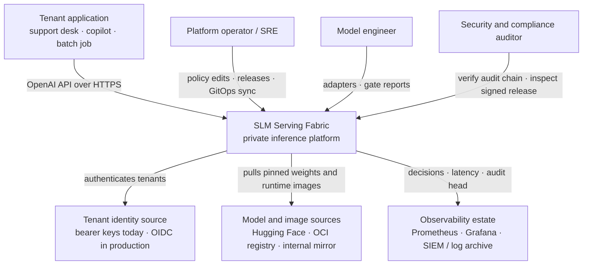
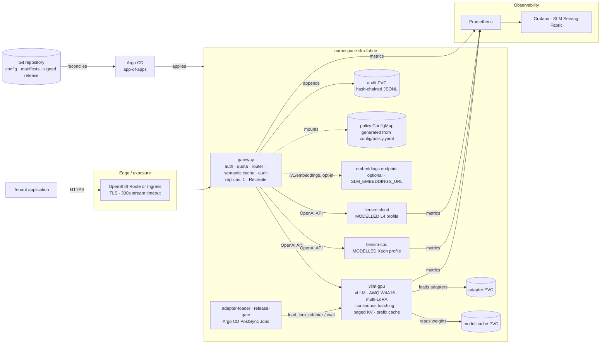
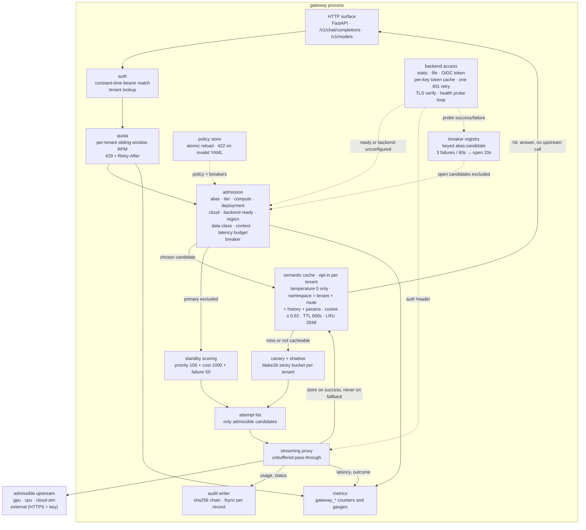
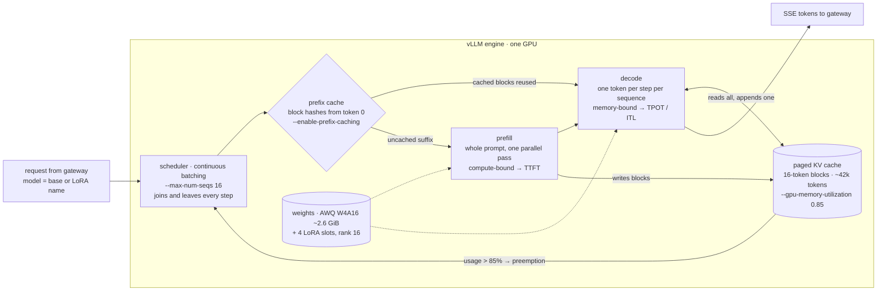
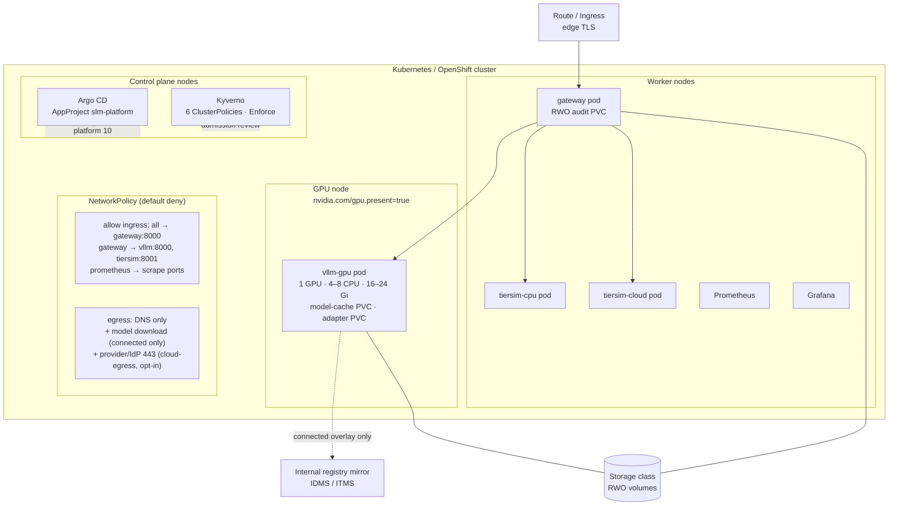
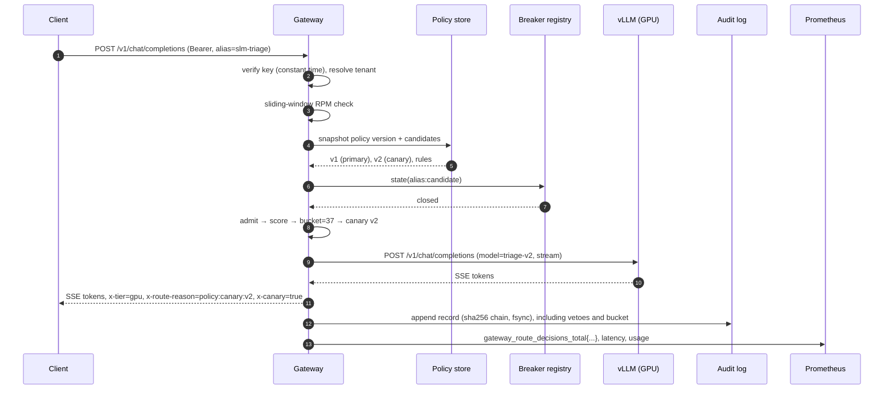
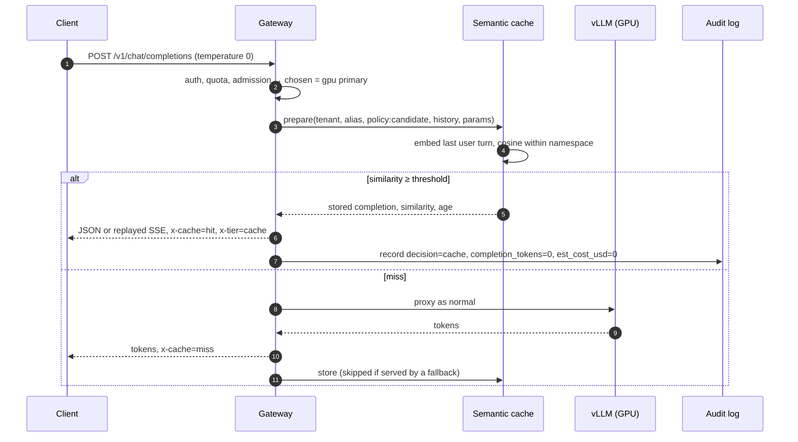
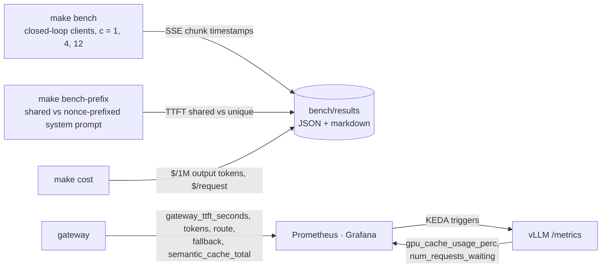
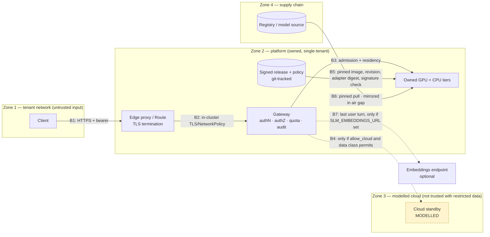

# Architecture — C4 views

Four levels, one runtime view and one trust-boundary view. Every element maps to a file
or a running container in this repository; nothing here is aspirational. Elements marked
**MODELLED** are calibrated simulators, not hardware.

Read with the [sign-off pack](../signoff/README.md) open: the acceptance checklist and
risk register reference these views by section.

- [L1 — System context](#l1--system-context)
- [L2 — Containers](#l2--containers)
- [L3 — Gateway components](#l3--gateway-components)
- [L3 — GPU serving engine](#l3--gpu-serving-engine)
- [L4 — Deployment](#l4--deployment)
- [Runtime view — one request](#runtime-view--one-request)
- [Runtime view — semantic cache hit](#runtime-view--semantic-cache-hit)
- [Measurement view](#measurement-view)
- [Trust boundaries](#trust-boundaries)

---

## L1 — System context

Who uses the platform, and what it depends on outside its own perimeter.

What the context makes explicit:

- **The client contract is the OpenAI API**, not a vendor SDK. Migrating from a hosted
  provider is a base-URL and key change; the model alias stays stable across releases.
- **The auditor is a first-class actor**, not an afterthought. Verification endpoints and
  signed manifests exist so an auditor can answer "what ran, and why" without database
  access.
- **External supply is limited to pinned artifacts.** The runtime pulls a pinned image and
  a pinned model revision; an air-gapped install pulls neither at runtime.

## L2 — Containers

Runnable units, stores and the data they exchange.

Container-level decisions worth stating:

| Container | Why it is separate | Failure containment |
|---|---|---|
| `gateway` | The only holder of tenant identity, quotas, breakers, semantic cache and audit state | Losing it refuses requests and empties the cache; it cannot corrupt model state |
| `vllm-gpu` | One whole GPU and KV-cache budget per replica; scales 1–3 by queue depth and cache pressure | Restart or eviction delays capacity and drops its prefix cache, does not lose release provenance |
| embeddings endpoint | Optional; only when paraphrase-level cache hits are wanted. The default trigram embedder runs inside the gateway | A failure or timeout (2 s) is a cache miss, never a failed request |
| `tiersim-*` | Modelled standbys that make residency decisions executable | Labelled `x-simulated: true` at the API boundary; never mistakable for measured |
| Prometheus | Independent scrape loop | Gateway degradation is visible without asking the gateway |
| Argo CD | Reconciles Git, not the operator's laptop | Drift is reported while the old state still serves |

The gateway is a single replica **on purpose**: rate-limit windows, breaker state, the
semantic cache and the audit hash chain are in-process. Two replicas would partition quotas and interleave two
writers into one chain. Scaling it out requires moving that state to a shared store first;
that trade-off is recorded in ADR-0004 and ADR-0006.

## L3 — Gateway components

The request path, in the order the code executes it.

Three properties are structural, not conventions:

1. **Admission runs before scoring, and before the cache.** A cheap cloud candidate that fails residency is not
   scored and cannot become a fallback. The attempt list is built from the same admission
   pass, so a fallback can never be a route the tenant is not entitled to. The semantic cache is
   consulted only after admission has chosen a candidate, and that candidate is part of
   the cache namespace: a hit can never bypass a residency or alias veto, and a canary and
   its primary never answer for each other.
2. **Audit and metrics are side channels fed by the result**, never inputs to the decision.
3. **Credentials are resolved, not stored.** `KEYS` turns a policy key reference into an
   auth header at request time — a value from the mounted keys file (`static`), a file
   under the token directory read per request (`file`), or a client-credentials token
   cached per key in this process (`oidc`). A missing key is an admission veto
   (`backend-unconfigured`), so an unconfigured route degrades to a documented refusal
   instead of a failed call. A `file` or `oidc` credential that expires gets exactly one
   refresh-and-retry on a 401. The same loop's probe results feed the breaker registry.
   A failing audit write is logged and does not fail the request — an availability
   trade-off recorded in ADR-0004.

## L3 — GPU serving engine

Inside `vllm-gpu`: what one replica does with a request, and where each tuning flag acts.
This is the runtime's own design (ADR-0001); the platform's choices are the flags.

| Concern | Setting | Decided in |
|---|---|---|
| Context per request | `--max-model-len 8192` (5 full-length sequences fit; 16 at ~2.6k average) | [serving checklist](../llm-serving-checklist.md#the-reference-gpus-memory-budget-items-2-12-13) |
| Batch width | `--max-num-seqs 16`; KEDA adds a replica at 4 waiting per replica or 85% KV usage | ADR-0008, `config/capacity.yaml` |
| Shared-prompt prefill | `--enable-prefix-caching`, enforced by `validate_deploy` | checklist item 11 |
| Quantisation | AWQ W4A16 via the marlin kernel | ADR-0002 |
| Splitting a model | TP = 1, PP = 1; scale by replicas until a model exceeds one card | ADR-0014 |
| Speculative decoding | Off; n-gram first when an alias runs at c ≤ 2 | ADR-0015 |

Two layers of caching, deliberately different:

| | Prefix cache (engine) | Semantic cache (gateway) |
|---|---|---|
| Saves | prefill of a shared prefix | the whole request: prefill, decode, GPU slot |
| Matches | exact token blocks from the start | near-duplicate last user turn, rest exact |
| Scope | one replica, all tenants (KV only, never output) | one gateway, one tenant + route |
| Default | on | off; tenant opts in |
| Correctness risk | none, output is still generated | a near-miss answer, so temperature 0 only |

## L4 — Deployment

Physical placement on the reference substrate (OpenShift). The vanilla overlay differs only
in exposure (Ingress instead of Route) and UID assignment; the air-gap overlay differs only
in egress and mirror configuration.

Deployment invariants (enforced by `tools/validate_deploy.py` on the rendered output):

- vLLM runs the release-pinned image tag and model revision; `Recreate`, one GPU request
  equal to the limit.
- Every workload is non-root with `RuntimeDefault` seccomp and `ALL` capabilities dropped;
  vLLM is the single writable-root-filesystem exception, because CUDA/Triton caches write
  outside `/tmp`.
- The policy ConfigMap is byte-identical to `config/policy.yaml`, and every backend host in
  the policy resolves to a Service in the same render.
- No `Secret` is committed; `slm-tenants` is created out-of-band by `make deploy-secret`.
- The air-gap overlay has no internet egress and sets offline flags on vLLM.
- `config/fleet.yaml` names every cluster that hosts a pool, with exactly one `primary`;
  `tools/fleet_status.py --check` validates that offline and `--live` adds a read-only node
  count per cluster. It is an inventory, not an orchestrator: no cluster in it is contacted
  to route traffic.

## Runtime view — one request

The path a single `slm-triage` request takes when the canary slice selects v2 and the GPU
tier is healthy.

If the GPU is down, steps 7–10 become: the first three attempts fail at transport level,
the breaker opens, and the next request scores the admissible standbys. For an EU
confidential tenant the cloud candidate carries `region-veto`, so the CPU simulator serves
and the audit record contains that veto. The measured drill is in the README.

## Runtime view — semantic cache hit

A tenant with `semantic_cache: true` sends a question that nearly repeats one already
answered on the same route.

## Measurement view

How each serving metric is produced, so a number in a report can be traced to the code
that measured it.

| Metric | Phase it measures | Source |
|---|---|---|
| TTFT | queue + prefill | `bench` (client side), `gateway_ttft_seconds` (gateway side) |
| TPOT | decode, per request: `(last − first token) / (tokens − 1)` | `bench` |
| ITL p95/p99 | decode stalls: preemption, prefill landing in the batch | `bench`, pooled chunk gaps |
| Prefix-cache saving | prefill avoided | `bench-prefix` TTFT delta |
| Cache hit rate | requests that skipped the GPU | `gateway_semantic_cache_total{result}` |
| KV pressure, queue | capacity, autoscaling | `vllm:gpu_cache_usage_perc`, `vllm:num_requests_waiting` |

## Trust boundaries

| Boundary | What crosses | Control | Residual risk |
|---|---|---|---|
| B1 client → edge | Prompts, keys, tenant identity | TLS at the Route; bearer key compared in constant time | Keys are long-lived; production should use OIDC and short-lived tokens (see risk R-04) |
| B2 edge → gateway | Authenticated HTTP | Default-deny NetworkPolicy; only the edge namespace reaches `gateway:8000` | In-cluster traffic is not mTLS (R-05) |
| B3 gateway → owned tiers | Prompt text, model output | Residency and data-class admission; owned tiers only for `confidential` and `restricted` | Prompt content is not inspected for secrets (R-06) |
| B4 gateway → cloud | Prompt text, if permitted | `allow_cloud`, `serves_regions`, sovereignty veto, optional latency budget; external candidates are HTTPS-only, authenticated by a key reference resolved at request time (`static`, rotating `file` or OIDC token) and gated by an opt-in TCP-443 egress rule; health probes feed the breaker | A mis-set tenant policy can permit egress (R-07); no live provider or IdP has validated the path (R-18, N-13) |
| B5 release → runtime | Image, weights, adapters | Signed manifest pins digests; admission policies reject unpinned images; gate runs before promotion | A registry can withhold a pinned digest (R-02, closed by C-02) |
| B7 gateway → embeddings | The last user message of opted-in tenants' cacheable requests | Off unless `SLM_EMBEDDINGS_URL` is set; the default embedder is in-process. Run the endpoint in Zone 2 | Cached completions sit in gateway memory, per tenant, until TTL; a memory dump exposes them like any in-flight prompt |
| B6 supply chain → runtime | Base image, model revision | Pinned revision and image tag; air-gap mirror with an auditable image list | Upstream compromise of a pinned artifact is not detected locally (R-03) |

The audit chain is tamper **evidence**, not prevention: a writer with filesystem access can
rewrite the whole chain. Shipping the head hash to a separate sink is a deployment
requirement, not a feature of the binary (ADR-0004, risk R-01).

---

## How these views stay true

| View | Enforced by | Fails when |
|---|---|---|
| L2 container list | `tools/validate_deploy.py` (`REQUIRED_SERVICES`, `REQUIRED_DEPLOYMENTS`) | A Service or Deployment is renamed or removed |
| L2/L4 policy binding | `check_policy_binding` — every backend host resolves to a Service port (external candidates are exempt) and `check_external_backends` — keys mount, `SLM_BACKEND_KEYS`, egress rule | Policy and manifests drift |
| L4 external route | `check_pools` (external flag vs `access`), `check_cloud_egress`, `tests/test_backends.py` | A credential is added to an in-cluster pool, or egress is widened beyond one public range on TCP 443 |
| L4 pinned runtime | `check_model_pin` + `tools/validate_release.py` | Image tag, revision or served name changes without a new release, or prefix caching is dropped |
| L3 semantic cache | `tests/test_semantic_cache.py` (namespace isolation, temperature-0 rule, TTL/LRU, real app with stubbed upstream) | A cache hit crosses a tenant, route or conversation, or a sampled request is cached |
| Measurement view | `tests/test_bench.py` (TTFT/TPOT/ITL arithmetic, SSE timing, prefix-probe report) | A metric's definition changes silently |
| L4 security posture | `check_security`, `check_resources`, `check_probes`, Kyverno policies | A workload loses its context, limits or probe |
| L3 routing semantics | `tests/test_router.py` (admission before scoring, breaker keys, latency budget, audit chain) | A candidate becomes admissible or a break is skipped |
| L3/L4 declared capacity | `check_pools` — every candidate `latency_ms` equals its pool `slo.expected_latency_ms`, cost within 1e-9, `modelled` may not claim `measured` | A candidate quietly understates latency or cost |
| L4 fleet inventory | `tools/fleet_status.py --check` (one primary, every pool hosted once) and `tests/test_fleet.py` | A pool is orphaned, hosted twice, or a second primary appears |
| Signed release chain | `python -m registry verify` and `python -m tools.validate_release` | Policy, gate report, golden set or adapter weights change after signing |
