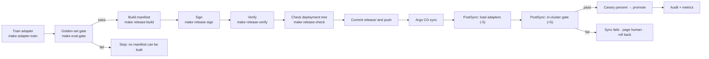

# Release process

A release is a signed statement of six things: model revision, adapter digests, image tags,
policy version, gate result, and the benchmark/cost evidence used to justify promotion. The
process below is what produces and consumes that statement.

## Roles

| Role | Owns | Never has |
|---|---|---|
| Model engineer | Training data, adapter training, gate report | The release signing key |
| Release manager | Manifest build, signature, release commit | Cluster admin |
| Platform operator | GitOps sync, canary percentage, rollback | Adapter weights |
| Auditor | Verification and evidence review | Write access to any of the above |

Separation is only meaningful if the key is not on the same machine as model training. In
this reference build both live on one laptop; that is a stated limitation, not a design
choice ([R-04](risks.md#r-04--static-bearer-keys)).

## The pipeline



### 1. Produce the candidate

```bash
make adapter-data          # deterministic synthetic dataset
make adapter-train         # QLoRA v1 and v2, then hot-load them
make adapter-eval          # 200-ticket held-out comparison
make eval-gate             # floors + drift against bench/results/eval-baseline.json
```

The gate is the authority. It fails on absolute floors (schema, exact labels, slices) and on
drift against the committed baseline. Training loss is not a gate input: both adapter runs
memorised the templates to <1e-5 while differing by 33 points on held-out exact labels.

### 2. Build and sign the manifest

```bash
# once per key, on the release machine
make release-key           # writes release/keys/release.ed25519.pem (gitignored)

make release-build         # config/release.yaml + artifacts -> release/<id>.json
make release-sign          # Ed25519 over canonical JSON -> release/<id>.json.sig
make release-verify        # signature + required fields + gate passed
make release-check         # rendered overlays == signed manifest == evidence hashes
```

`release-build` refuses to produce a manifest when the gate failed, an adapter directory is
missing, an image is unpinned, or the policy/gate artifacts cannot be hashed. There is no
force flag for a failing gate.

What is signed is the **canonical JSON form**: keys sorted, no insignificant whitespace,
UTF-8. Reformatting the file for review does not break the signature; changing a value does.
Ed25519 is deterministic, so re-signing the same manifest produces byte-identical signature
files — useful when two people need to confirm they signed the same thing.

### 3. Publish

```bash
git add release/ config/release.yaml
git commit -m "Release slm-0.5.0"
git push
```

Argo CD reconciles `deploy/gitops/apps/platform.yaml`. Sync waves apply policy and admission
policy before workloads. Two PostSync hooks then run in order:

| Weight | Hook | Purpose | Failure mode |
|---|---|---|---|
| -5 | `adapter-loader` | `load_lora_adapter` for each name in `slm-adapter-set` | Job retries until the deadline; sync fails; old adapters keep serving |
| +5 | `release-gate` | Scores the deployed adapter on the golden set, directly against vLLM | Sync fails; the release is visibly degraded in Argo, not silently live |

A failed hook does not roll back automatically. The gateway is `Recreate`, so there is no
old pod to flip back to; the intended human action is in
[operations.md](operations.md#rb-03--failed-release-gate). Automatic rollback is condition
C-08.

### 4. Promote

Promotion is a policy edit, not a redeploy:

```yaml
# config/policy.yaml
slm-triage:
  canary:
    candidate: v2
    percent: 50      # raise to 100 to promote, drop to 0 to roll back
```

Reload is atomic and admin-scoped:

```bash
curl -s -X POST http://gateway:8000/v1/policy/reload \
  -H 'Authorization: Bearer <admin-key>'
```

An invalid YAML file returns **422** and the previous policy keeps serving. Because the
canary bucket is `blake2b("canary:<alias>", tenant) mod 100`, a given tenant stays on one
side of the line across requests and restarts — a release does not reshuffle tenants.

### 5. Roll back

| Scope | Action | Time |
|---|---|---|
| Canary regression | Set `canary.percent` to 0, reload | seconds, no restart |
| Bad adapter weights | Load the previous adapter name and repoint the alias | seconds (runtime LoRA load) |
| Bad gateway or policy | Revert the release commit; Argo syncs the previous tree | one sync |
| Bad base model or quantisation | New release required; the GPU tier restarts | minutes |

The first three are covered by the policy and adapter mechanisms. The fourth is a full
release because the pinned revision is part of the manifest — that is deliberate.

## What signing proves — and what it does not

**Proves:** the manifest bytes were signed by the holder of the private key corresponding to
the committed public key; the signed values describe the artifacts that are deployed now
(`make release-check` binds all three).

**Does not prove:** that the builder was honest, that the gate was run on the same hardware,
that the private key was not copied, or that the image on the registry is what the tag
points to (tags, not digests, are pinned — [R-02](risks.md#r-02--images-pinned-by-tag-not-digest)).

A Sigstore/cosign + in-toto attestation would close the identity and transparency gaps. It
was rejected for this build because it adds a CA dependency, network access to a transparency
log, and a second credential system, while the review target is an air-gapped site. See
[ADR-0007](../adr/ADR-0007-signed-releases.md).

## Key custody

| Environment | Private key | Public key | Rotation |
|---|---|---|---|
| This repository | `release/keys/release.ed25519.pem`, gitignored, generated locally | `release/keys/release.ed25519.pub.pem`, committed | Regenerate with `make release-key --force`; commit the new public key and re-sign the current release |
| Production | HSM or KMS-held key, non-exportable, signing as a service | Published in the operator's trust bundle and in the air-gap install medium | Annual and on personnel change; keep the previous public key to verify old manifests |

Because the verification key is committed, anyone can verify a release offline:

```bash
openssl pkeyutl -verify -pubin \
  -inkey release/keys/release.ed25519.pub.pem -rawin \
  -in <(python -c "import json,sys;print(json.dumps(json.load(open('release/slm-0.5.0.json')),sort_keys=True,separators=(',',':')),end='')") \
  -sigfile release/slm-0.5.0.json.sig
```

## Release states

| State | Meaning | Allowed transitions |
|---|---|---|
| `candidate` | Gate report exists, no manifest | → `signed` (gate passes), → rejected (gate fails) |
| `signed` | Manifest + signature committed, not synced | → `deployed`, → `superseded` |
| `deployed` | Argo synced, hooks passed, canary percentage set | → `promoted`, → `rolled-back` |
| `promoted` | Canary at 100% | → `superseded`, → `rolled-back` |
| `rolled-back` | Canary at 0%, previous adapter serving | → `candidate` after a fix |
| `superseded` | A newer signed release is deployed | terminal |

There is no mutable "current version" elsewhere: the manifest is the version, the policy
selects the candidate, and the audit record names the model version that answered.
